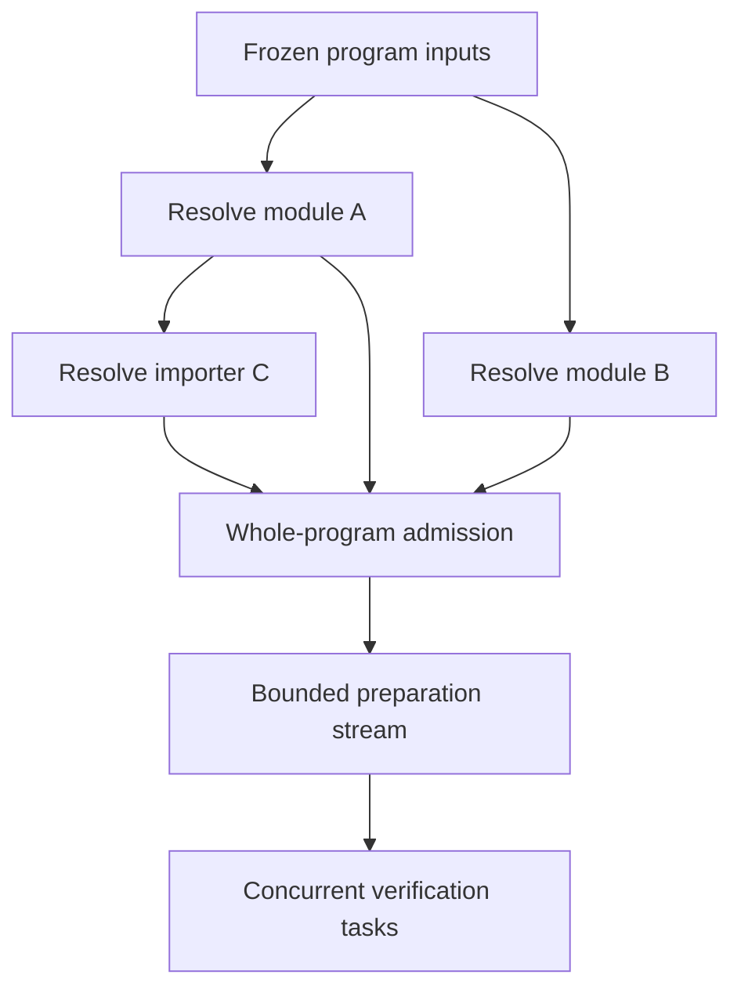

# Removing repeated work and unnecessary sequentiality from verification

## Status, scope, and recommendation

This is the design study requested in [issue #241, final design request][request].
It proposes implementation work; it implements none of it. No Dafny executable,
build, solver, or verification test was run for this study. Numerical observations
below are the measurements published in that request, or calculations explicitly
derived from them. Other performance claims are models to be measured, not results.

The source snapshot is `erniecohen/dafny` at
`d0301c6f702dabada677d99c3ebf63745f357d9c`, the head of `review/4.11.0` read for this
study. The measured release tag, `v4.11.0+fcb2042d.review.06a2267a`, points to that
same commit; the version suffix is not the commit prefix. Boogie is the release
`v3.5.5+review.a7d160a7` selected by [nuget.config][nuget] and
[Scripts/boogie-packages.sha256][boogie-packages], whose tag points to
`7873c81883456dfc98fabd84b5d3b6d132417219`. Source links below pin these snapshots.

**Recommendation:** finish and measure the existing module window and exact
background replay work, then reduce allocation in Boogie's repeated traversals.
Next add an exact task-result cache through the modern verification-task API,
first at a late, readily auditable boundary, then at an earlier boundary that can
skip VC construction. Improve the IDE's existing resolution cache before building
a replacement. Parallel translation and resolution need explicit ownership and
deterministic publication; a general import-DAG pipeline additionally needs a
solution for whole-program admission checks.

Five findings materially qualify the issue's initial description:

1. The CLI does have a module barrier, and its translator mutex covers **Boogie
   preparation as well as Dafny-to-Boogie translation**. Preparing one module can
   overlap solving another without removing that mutex. [CLI][cli], [verifier][verifier]
2. With Dafny's default pruning, a checker is retargeted for individual splits.
   `FullReset` discards preparation state; light `Reset` already replays prepared
   common text. The useful background identity is the **ordered pruned context**,
   not merely the containing Boogie program. [pool][pool], [checker][checker],
   [interactive prover][interactive]
3. IDE module-resolution caching already exists and `--use-caching` defaults to
   true. Edits still trigger a new whole-program resolution transaction and global
   passes, but unchanged module bodies can be cache hits. A 38.9-second cold CLI
   resolve does not establish a 38.9-second cost after every IDE edit.
   [resolver entry][resolver-entry], [resolution cache][resolution-cache]
4. A persistent cache cannot safely be made by serializing Boogie's current basic
   cache. Its key is incomplete for cross-process reuse, and the modern task path
   does not insert completed results into that implementation cache.
   [task API][task], [engine][engine], [basic cache][basic-cache]
5. Import completion is not sufficient to authorize translation. This fork has a
   whole-program cardinality-validation receipt, including dependencies from a
   trait to downstream implementers. An import-only streaming design can bypass a
   soundness check. [program resolver][program-resolver], [cardinality][cardinality],
   [generator][generator]

Server GC remains an external environment choice. This plan changes no runtime
configuration, wrapper, or GC default, and every proposed optimization must be
measured under both workstation and server GC.

## 1. What the supplied measurements establish

### 1.1 Observations and arithmetic

The standard-library corpus is
`Source/DafnyStandardLibraries/src/Std/dfyconfig.toml`: 1,721 symbols, with 7,584
verified, 2 errors, and 26 out-of-resource results in every reported configuration.
The following table reproduces the published measurements. [Measurement source][request]

| Configuration | Wall seconds | Mean busy cores, Dafny + Z3 | Peak RSS GB |
| --- | ---: | ---: | ---: |
| 1 core, workstation GC | 282.6 | 1.12 | not supplied |
| 4 cores, workstation GC | 131.1 | 2.93 | not supplied |
| 18 cores, workstation GC | 124.7 | 3.18 | 2.13 |
| 4 cores, server GC | 90.0 | not supplied | 4.16 |
| 18 cores, server GC | 77.8 | 4.94 | 4.44 |
| 18 cores, server GC, larger generation 0 | 73.3 | not supplied | 6.52 |

Derived comparisons:

- Going from 4 to 18 cores under workstation GC buys only `131.1 / 124.7 = 1.051`
  times speed, despite 4.5 times as many configured solver slots.
- Server GC at 18 cores buys `124.7 / 77.8 = 1.603` times speed, with
  `4.44 / 2.13 = 2.085` times the reported peak RSS.
- Enlarging generation 0 buys another `77.8 / 73.3 = 1.061` times speed, with
  `6.52 / 4.44 = 1.468` times the RSS. It is not a substitute for reducing allocation.
- Mean utilization is about 17.7% and 27.4% of 18 cores respectively. These figures
  are symptoms of exposed waits and insufficient ready work, not forecasts of an
  available 5.7-times or 3.6-times speedup.

The larger corpus in #241 has 768 files, 649,500 lines and 18,357 symbols. The
`resolve` command takes 38.9 seconds at about one core, peaking at 5.03 GB. This
command includes front-end work; it is not an isolated timing of type inference.
Verification reaches 1,523 symbols at 500 seconds under workstation GC and 2,759
at 508 seconds under server GC. These are incomplete runs with unequal proof
costs; symbol throughput must not be extrapolated as though every symbol had the
same cost. The roughly 100-minute completion estimate remains an extrapolation.
If it were accurate, eliminating all 38.9 seconds would save only 0.65% of a cold
full run. The same front end can dominate a warm result-cache run or an edit.

### 1.2 Interpretation limits that matter to the design

The reported 383.6 managed thread-seconds include 208.6 in `Thread.PollGCWorker`
and 36.0 in lock contention. They must not be treated as 383.6 seconds of useful
on-CPU work, nor may the 208.6 seconds be subtracted from 124.7 wall seconds.
The sampled-thread-time profiler samples waiting threads too; overlapping waits
are counted on multiple threads. Its documentation explicitly distinguishes it
from kernel CPU sampling. [dotnet-trace documentation][dotnet-trace]

Likewise, a GC-safe-point stack in `ForallExpr.StdDispatch` identifies a place
where a thread was stopped, not necessarily an allocation by that function.
`StdDispatch` itself dispatches to a visitor. The cited sites are useful leads;
allocation-byte samples, GC pause intervals, and lock **hold** times are needed
to apportion savings. Finalizer samples do not identify the disposable object
responsible. There is no evidence here for adding forced collections or removing
finalizers speculatively.

The measured GC-mode response and the concrete reconstruction paths below support
allocation reduction as the first priority. They do not establish that the module
barrier alone is the main cost, that all 18 cores can be kept useful, or that
parallel resolution will materially shorten the standard-library run.

### 1.3 Performance model

Use a timing graph rather than adding overlapping phase timers. Let:

| Symbol | Meaning, to be recorded |
| --- | --- |
| `F` | Source discovery, loading, parsing, resolution and global admission on the critical path |
| `t_m`, `b_m` | Translation and Boogie preparation for module `m` |
| `a_j`, `q_j` | Host preparation and solver CPU work for check `j` |
| `P`, `K` | Worker limit and number of admitted modules |
| `L` | Longest dependency path, with phase durations as edge/node weights |
| `G_g(A,H,K)` | Exposed GC time under GC mode `g`, allocation volume `A`, live heap `H` and concurrency `K` |
| `W_lock` | Critical-path delay from lock ownership, not sum of waiter samples |
| `h` | Fraction of bypassable **cost** covered by cache hits, not fraction of symbols |
| `N`, `U` | Number of context rebuilds and distinct exact prepared backgrounds |

Every speedup below is `T_old / T_new`. For a part with exposed fraction `f` and
local speedup `s`, Amdahl's model is `1 / ((1-f) + f/s)`. For allocation reductions
use the measured difference in `G_g`, not a presumed linear relationship between
bytes and wall time. For a parallel phase with work `W` and critical path `L`,
`max(W/P, L)` is a lower bound, not an attained running time.

## 2. Current execution and repeated-work inventory

### 2.1 CLI path

`VerifyCommand.HandleVerification` creates and starts `CliCompilation`, then waits
for `Compilation.Resolution`. `Compilation` discovers project roots and libraries,
parses, clones the parsed AST for consumers, and runs resolution. Only a successful
whole-program resolution exposes verifiable symbols. [command][verify-command],
[compilation][compilation]

`CliCompilation.VerifyAllLazily` groups selected symbols by containing module,
orders modules and declarations by their existing origin positions, schedules a
module, consumes its completed results in order, and clears that module's cache
before proceeding. The first symbol of a module creates one lazy module
translation; other symbols reuse it. `DafnyProgramVerifier.GetVerificationTasksAsync`
holds its semaphore through translation **and** `ExecutionEngine.GetVerificationTasks`.
That Boogie method resolves/types the generated BPL, eliminates dead variables,
collects modifies, coalesces, inlines, preprocesses the program, prepares each
implementation, and constructs all manual splits into a list before returning.
[CLI][cli], [verifier][verifier], [engine][engine]

`Compilation.verificationTickets` preserves symbol scheduling order; it is
returned after task submission, not after solving finishes. The large-stack
scheduler is multi-worker. Neither should be mislabeled as the per-module solver
completion barrier. Actual solver capacity is bounded by the checker pool.
[compilation][compilation], [scheduler][scheduler], [pool][pool]

### 2.2 Inventory

Locations name methods as well as files so the study remains usable after line
numbers move. Boogie paths refer to the separately pinned Boogie repository.

| Work or sequentiality | Code and actual owner/barrier | Cost model and present evidence |
| --- | --- | --- |
| Discover/open project and transitive include/library inputs again per CLI invocation | `Compilation.DetermineRootFiles`, `ParseAsync`; `ProgramParser`; process-local caches | I/O + parsing + hashing + cloning. Part of `F`; not separately measured. |
| Parsed-tree cloning and file-level invalidation | `Compilation.ParseAsync` clones the program; `CachingParser` clones cached file results | At least traversal/allocation proportional to retained input. A small edit can replace identities of several modules from one file. |
| Resolve all modules in sequence | `ProgramResolver.Resolve`, loop over topologically sorted declarations; `DafnyLangSymbolResolver.resolverMutex` | `sum r_m` plus global passes. The large cold `resolve` total is 38.9 s; module distribution and DAG width unknown. |
| Global before/after-resolution work | Dependency graph, heights, system module, rewriter `PreResolve`/`PostResolve`, replaceable modules, duplicate names, cardinality validation | Serial floor `R_global`; some passes are admission conditions, not gratuitous barriers. |
| Re-resolve `.doo` contents, including packaged Std | `DafnyFile.HandleDooFile`; `DooFile.Read/Write` stores pre-resolution source text | `.doo` skips verification/compilation where appropriate, not parsing/type resolution. Cost is part of `F`. |
| Reparse and resolve the Boogie prelude for each translator | `BoogieGenerator` constructor, `ReadPrelude`, `FindPredefinedDecls` | Approximately module count times prelude parse/resolve cost. #173 snapshots text for a batch but still reparses that text. |
| Resolve-all-before-translation | `VerifyCommand`, `Compilation.VerifyCanVerify`, translation's cardinality receipt check | Startup floor `F`; cannot remove by translating merely when direct imports finish. |
| Finish one module before admitting the next | `CliCompilation.VerifyAllLazily`, lines 266–326 | Sum of module tails, including low-ready-work intervals. K-window work already underway addresses this. |
| Serialized module translation and preparation | `DafnyProgramVerifier.mutex`, lines 38–69 | `sum(t_m+b_m)` service capacity; module-window overlap can hide some of it. Std Dafny front-end sampling is small; Boogie preparation is a separate quantity. |
| Eager preparation of every implementation and split in a module | `ExecutionEngine.GetVerificationTasks`, lines 864–905 | Rebuilt control-flow/passified structures and manual splits; selected-task filtering happens later in the modern caller. |
| Per-split context selection and declaration reordering | `CheckerPool.PrepareChecker`, `Checker.Target/Setup`; default `Prune=true` in `DafnyOptions` | Used-type traversal, context reset and ordering for each split. Repetition governed by `N/U`, not just number of modules. |
| Shared-program setup lock | `Checker.Setup`, `lock(Program.TopLevelDeclarations)` | Serializes declaration registration and axiom translation for checkers targeting the same BPL program. A module window may distribute this contention. |
| Per-implementation VC lock | `Split.BeginCheck`, `lock(Implementation)` | VC generation and quantifier instantiation for sibling splits serialize on one implementation. More independent modules do not remove this lock. |
| Expansion and type-erasure work | `IAppliableTranslator.ApplyExpansion` in `Boogie2VCExpr.cs`; `VCExpr2String` | Expansion lock and `lock(gen)` protect mutable state. Supplied waiter samples: 18.9 s and 2.6 s respectively, not projected wall savings. |
| Reconstruction by VC visitors | `MutatingVCExprVisitor`, type erasers, let sorting, linearization | Lists, expressions, substitution state, string builders and SMT text created per traversal/check; measured allocation bytes still needed. |
| Avoidable copying in hot supporting operations | `MapType.GetHashCode`, `Type.GetHashCode`, `ReadOnlyVisitor.VisitTrigger` | Bound-variable/argument/list allocation per invocation; concrete sites, but no per-site allocation-volume measurement supplied. |
| Prover reset and background setup | `SMTLibInteractiveTheoremProver.Reset/FullReset/Check`; `SMTLibProcessTheoremProver.PrepareCommon/SetupAxioms/FlushAxioms` | Light reset replays text; full retarget resets context and rebuilds. Existing exact-background work addresses the latter. Solver still parses replayed bytes. |
| Global and shared mutable bookkeeping | `ProofDependencyManager`; `VisibilityScope`; Boogie node IDs, quantifier-pool tables, namer/log registries and mutable options | Correctness/ordering hazards, not all measured hot locks. An atomic counter alone does not preserve serial name assignment. |
| Repeated front-end transaction in IDE | Edit → new `Compilation` → cached parser/resolver → global checks → diagnostics | A transaction happens per edit; module bodies can be hits. Measure hit/miss and global-pass costs before calling it full re-resolution. |
| Repeated proof work across CLI processes | CLI supplies `EmptyVerificationResultCache`; modern `VerificationTask` retains its own completed status | No durable results. Current basic cache lacks a portable environment key; modern completion does not populate it. |
| Repeated filtered requests | #173 captures a resolved program and prelude text, but recreates tasks/translations and a proof-dependency manager per request | Intentional fresh-check semantics for duplicate/overlapping filters; must not be silently converted to result reuse. |
| Reporting and retained result objects | CLI output order; results retain task/split/program/dependency references; synchronized output writers | A K-module limit is not by itself a total-RSS bound. Finished results and solver contexts may retain program graphs. |

Evidence for the inventory is collected in the pinned [Dafny](#source-index-dafny)
and [Boogie](#source-index-boogie) source indexes. This inventory distinguishes
the modern task path from older CLI/snapshot paths; locks in an unused legacy path
must not be charged to the measured run.

## 3. Behavioral contract and eligibility

### 3.1 Three properties to establish separately

1. **Admission and obligation equivalence:** the same input is accepted or rejected,
   and the same obligations, assumptions, assertion batches, filters, diagnostics
   and exit-code aggregation are produced. Cached results never bypass current
   parse, resolution or global admission errors.
2. **Encoding equivalence:** for a fresh execution, each obligation produces the
   same ordered SMT command stream, effective limits and seed. Logical equivalence
   alone does not preserve solver heuristics or RU. Treat names, triggers, labels,
   declaration order and the protocol around `check-sat` as observable inputs.
3. **Outcome equivalence:** under a deterministic solver execution configuration,
   the same verdict and per-check RU result. This requires more than property 2:
   process history can affect RU even after `(reset)`.

The current standard-library runner documents both randomized literal hashing
and Z3 process-history effects. It uses `/deterministicLiteralHashes:1` and
`/restartProver`, and removes wall timeouts for its stable comparisons. These are
existing opt-in controls, not new defaults proposed here. [Std runner][std-runner]

### 3.2 The literal constraint has a boundary

An execution-time optimization cannot universally preserve a wall-timeout verdict:
the same check may now finish just before a deadline. `--verification-time-limit`
defaults to 30 seconds; there is also a host-side timeout around `BeginCheck`.
Memory exhaustion and external cancellation have the same issue. No hash key can
encode the future operating-system schedule. [Boogie options][boogie-options],
[task execution][task]

To comply with the requested equality rather than quietly weaken it, introduce a
conservative eligibility predicate for each optimization. Persistent result reuse
and changed scheduling require fixed solver/runtime identity, deterministic
ordering, an independent fresh solver history, deterministic resource limits, and
zero effective wall limits (including declaration attributes and pass-through
options). Unsupported tasks/configurations take the existing path. Initially,
fall back for the whole invocation when global scheduling cannot isolate an
ineligible task. Do not enable `/restartProver` or change a limit behind the user's
back: comparisons set the same explicit options on both runs.

Allocation/representation changes must preserve inputs for all supported option
combinations and, under this issue's strict verdict contract, also use the
conservative fallback wherever they can affect a wall-limited result. Broad
timed-mode optimization would be a relaxation that this plan does not adopt.
Absolute equivalence under different
external kills, OOM or machine faults is not a meaningful executable guarantee.
This limitation is a design constraint, not a claim that the reported measurements
were wrong: their verdicts did agree across the tested runs.

### 3.3 Default path and output

Every optimization has a separate opt-in option. Names below are proposals unless
identified as already present. Do not bundle the new behaviors into a default
"fast" mode. An absent/false option reaches the existing algorithm, ordering,
cache behavior, output format and option defaults. Profiling/cache-hit information
goes only to an explicitly requested sidecar.

Raw deterministic fixture output must match byte for byte. Real elapsed times,
timestamps and pre-existing nondeterministic progress are compared as such; a
requirement that independently measured time strings be equal would already fail
on the unmodified program. Do not normalize substantive diagnostics, assertion
counts, SMT names or resource counts to make a comparison pass.

## 4. Options ranked by expected benefit relative to risk

This ordering separates cold whole-project throughput from warm/edit latency.
The two already-owned changes are prerequisites to measure, not duplicate work
packages. All speedups are conditional on the quantities in section 1.3; no new
speedup is claimed as measured.

| Priority | Option or family | Benefit model | Workstation GC | Server GC | Risk / disposition |
| --- | --- | --- | --- | --- | --- |
| Existing A | Bounded module window `K` | Replace sum of isolated module tails by a bounded schedule; lower bound includes total work/P, longest check and serialized preparation | More ready work can help or amplify collection pressure | More likely to exploit spare cores; still memory-limited | Moderate; retain current translation mutex initially, validate history/ordering |
| Existing B | Exact prepared-background replay | Avoid repeated preparation for each of `N-U` context uses; solver input ingestion remains | Reduces repeated allocations and collections | Reduces CPU and allocation too | Moderate; context key and restored metadata are correctness-critical |
| 1 | `/vcAllocationSharing:1` | `T'_g = T_g - saved_host_work - saved_GC_delay + overhead` | High priority given supplied GC evidence | Still useful; not dependent on server GC | Low to moderate for narrow copy removal; high for arbitrary AST memoization |
| 2 | `--verification-cache <directory>` | Warm late lookup removes hit checks below descriptor boundary; early artifacts can later remove preparation too | Potentially removes much repeated allocation once moved early enough | Saves the same logical work, possibly a smaller GC component | High soundness consequence, moderate implementation scope if deliberately coarse and success-only |
| 3 | `--resolution-cache-content` | Warm edit invalidates changed module plus importers whose effective interfaces changed | Avoids cloning/inference allocation | Also reduces serial latency | Moderate/high; improve existing cache, retain global admission |
| 4 | `/streamVerificationTasks:1` and frozen module preparation | Overlap implementation preparation prefixes with already-ready checks | Must bound live AST/split queue bytes | Can hide serialized preparation behind solving | Moderate/high; new producer API and mutation ownership |
| 5 | `--cache-prelude` | Save `(M-1) * parse_and_resolve(prelude)` minus cloning/materialization | Allocation saving if prelude cost is meaningful | Likely smaller CPU saving | Moderate; mutable Boogie declarations cannot be globally shared unguarded |
| 6 | `--translation-workers N` | Parallelize measured `t_m`, then independent `b_m`, subject to preparation DAG and publication | May worsen allocation pressure | Better headroom, not automatic scaling | High until shared AST/naming/proof state is isolated |
| 7 | `--library-resolution-cache <directory>` | Avoid library parse+resolve minus load/rebind/validation cost | Potential reduction in front-end allocations | Potential reduction in cold/warm front-end latency | High typed-snapshot trust/compatibility risk; build on option 3 |
| 8 | `--resolver-workers N` | `R_parallel >= R_global + max(sum r_m/N, L_resolve)` | Work stealing may expose GC bottleneck | Likely better throughput on wide DAGs | High; both inference engines need isolation and immutable imports |
| Deferred | Resolve/translate/verify on import-ready | At most hide eligible front-end/dependency latency behind later work | Same GC limits plus more retained snapshots | Same soundness barrier | General version not justified; retain global admission first |
| Excluded | Keep logical solver context across checks instead of reset | Might save replay/solver parse, but solver work and RU also change | Does not directly solve host allocations | Same issue | Violates requested equivalence; a separate future experiment |

These ranks are not immutable. If measured warm IDE time is mostly indexing, move
incremental indexes ahead of more inference caching. If the background cache has
`U` almost equal to `N`, prioritize allocation-free context construction instead
of retaining many one-use snapshots. If `b_m` dominates `t_m`, do not first invest
in parallel Dafny translation.

### 4.1 Existing module-window work: acceptance contract

Keep one invocation-wide solver capacity `P` and at most `K` admitted module
programs. Admit the next module when capacity is released; do not wait for the
oldest module solely to preserve printed order. Use a coordinator with a fixed
baseline module/declaration order, separate completion and publication, and
backpressure for buffered results. Preserve existing tie ordering rather than
inventing a new sort order.

Keep `DafnyProgramVerifier.mutex` initially. A preparation worker can translate
and prepare module `m+1` while module `m` is solving. Merely raising K does not
make preparation parallel, nor does it remove `Checker.Setup`'s per-program lock
or `Split.BeginCheck`'s per-implementation lock.

The implementation must register every symbol state before a completion callback
can use it, avoid concurrent writes to `canVerifyResults`, propagate exceptions
and cancellation to all pending completions, and release each module exactly
after its tasks and consumers release ownership. `ClearModuleCache` removes one
dictionary entry; it does not prove the BPL graph was reclaimed. Finished task
results, checkers, coverage data and logs can retain it. Store compact completed
records when possible, retain the required immutable dependency map, and budget
bytes as well as modules. Refill and publication must not deadlock behind one
slow module.

For isolated module makespans `v_m`, the old tail component resembles `sum v_m`.
A window can approach a work-conserving schedule with lower bound
`max(sum check_work/P, max check_duration, sum(t_m+b_m))`, plus `F` and only the
exposed GC/lock/startup/drain delays not already counted in those durations.
This is not `sum v_m/K`: modules have unequal widths and
preparation remains serial. Record ready-task counts and idle-slot integrals
before and after. Start experiments at K=1,2,4,8, stopping increases at the
memory/GC knee; do not infer K=18 from 18 cores.

**Acceptance:** deterministic per-task manifests/SMT/verdict/RU; identical final
diagnostic order; concurrency stress with instantaneous and delayed tasks;
cancellation during preparation and a prover failure in a later module; observed
K/live-byte bounds; no extra threads multiplying solver capacity. Original
history-sensitive or timed settings require the section 3 fallback. Under server
GC expect better scheduling opportunity; under workstation GC K can regress.

### 4.2 Existing background-cache work: exact prepared contexts

The reusable unit must include:

- the frozen program revision and **ordered** pruned declaration sequence;
- hide/reveal results and the effective `UsedTypes` sequence;
- type encoding, normalization and name-allocation policy, preamble/prelude
  contributions, solver dialect, effective options and actual split/iteration seed;
- common SMT commands and the host state required to continue: naming maps and
  counters, type-axiom builder baseline, declaration collector, datatype/function
  definitions, and named-assumption/proof-dependency decoding.

Store an immutable baseline plus private per-check deltas. Reusing only printed
assertions while continuing with inconsistent name/type maps can produce invalid
or incorrect later queries. A superset of axioms, another declaration order, or
deduplication of repeated assertions does not meet byte-identity requirements.
Keep all query-local declarations and axioms out of the baseline.

For background `b` used `n_b` times, preparation cost `A_b`, rehydration cost `d_b`
and total lookup/eviction overhead `H`, host work saved is approximately
`sum_b((n_b-1)*A_b - n_b*d_b) - H`, with a separately measured GC effect. Cache
retention is `sum resident(text_bytes + snapshot_bytes)` plus private deltas.
If most contexts are unique, retention can cost more than it saves. Hash/cache
the shared background once, not its entire text again for every split.

**Acceptance:** exact full command-stream comparison, including fresh query
commands and cleanup, after both reset kinds, context changes, seeds, pruning,
hide/reveal, type encodings and per-implementation solver overrides. Check that
snapshot names match the current proof mappings. The pinned `CachedCommon`,
`CachedAxBuilder` and `common` fields are not themselves a complete keyed cache;
review their reset lifecycle explicitly. This is an input to the existing worker,
not a claim of a newly reproduced bug. [interactive][interactive], [SMT setup][smt]

### 4.3 Allocation reduction and immutable sharing

Start with the allocation report already in progress. The following candidates
have source-level explanations independent of sampled GC safe points:

| Candidate | Current work | Proposed opt-in change and invariant |
| --- | --- | --- |
| `MutatingVCExprVisitor` | Allocates child/binding/trigger lists even when returning the original node; n-ary path also inserts at the front | Allocate replacement storage only at the first changed child; preserve visitor call order, list order and identity-sensitive behavior; size buffers once |
| `MapType.GetHashCode` / `Type.GetHashCode` | Allocates bound-variable lists and copies arguments to an array per hash | Reuse traversal-local scratch or use a nonallocating traversal that computes the identical integer; do not memoize hashes of mutable types/proxies |
| `ReadOnlyVisitor.VisitTrigger` | Copies `node.Tr` before visiting | Introduce a genuinely read-only traversal where proven safe; the existing visitor permits mutation and is not an immutability proof |
| Quantifier type erasure | Copies term/type binding dictionaries for nested binders | Parent environment plus scoped overlay; preserve shadowing, polarity, alpha bindings and exception unwinding |
| Type-axiom builder and namer cloning | Copies mostly unchanged maps/sets/lists for each check | Frozen base plus query-owned delta, retaining exactly the baseline enumeration and fresh-name order |
| Let sorting | Rebuilds binding/free-variable/occurrence dictionaries and lists | Avoid duplicate analysis within one immutable context; preserve topological tie order and unused-binding behavior |
| SMT printing | Repeated `StringWriter`, full common strings, builders and wrapper copies | Bounded task-local buffer reuse and immutable text chunks; preserve emitted bytes and command boundaries, cap retained capacity |

See [VC visitors][vc-visitor], [types][boogie-types], [standard visitor][visitor],
[erasure][erasure], [bindings][bindings], [type builder][axiom-builder],
[let sorting][let-sorter] and [linearizer][linearizer]. These are candidate edits,
not a license to remove all copies or intern arbitrary expression nodes.

`ApplyExpansion` takes `lock(app.Func)` even before testing whether its body is
null. A no-body fast path is possible only after the function body is frozen and
published. For nonempty bodies, cache a context-correct translated template and
perform substitution in private state, or use a proven read-only translator.
The key must include type arguments, binding environment, encoding, expansion
policy and context where relevant; caching by AST node alone is insufficient.
Preserve recursive expansion behavior and declaration/trigger ordering.
[Expansion implementation][expansion]

Do not remove `lock(gen)` on the assumption it is one global mutex. The generator
is normally checker-context owned; first record the lock object's identity and
the contenders. Similarly, `lock(Program.TopLevelDeclarations)` is per BPL
program and `lock(Implementation)` is per implementation. Fix ownership, freeze
state, and then remove only proven-unnecessary critical sections.

For both GC modes use `T'_g = T_g - delta_CPU_exposed - delta_GC_exposed + overhead`.
For example, if a later measurement finds 30% of wall time exposed in a targeted
stage and halves that stage, the model predicts `1/(0.7+0.3/2) = 1.176` times speed.
That is a sensitivity example, not an estimate that the current targeted fraction
is 30%. Obtain that fraction with section 8's allocation and interval measurements.

**Acceptance:** unchanged task/SMT bytes, nested-binding/type-cast/trigger controls,
shared-versus-private alias assertions, all supported type encodings (arguments,
premises and monomorphic when applicable), all enabled fork axiom families, and
false-assertion controls. Record
allocated bytes, retained heap, GC pause time and lock hold time separately.

### 4.4 Boogie preparation streaming and translation granularity

First make a `PreparedModule` boundary after global BPL resolution, typing,
inlining, dependency analysis and transformations. Its declarations/options are
frozen; each implementation has one preparation owner. Add a producer API that
prepares an implementation and yields its stable numbered splits into a bounded
channel. Retain the existing eager API and its default path. The new producer
feeds Dafny's existing task-status machinery while preserving the total selected
task manifest and source ordering.

Change `Split.BeginCheck` to consume an immutable `SplitInput` containing blocks
and control-flow maps instead of temporarily replacing `Implementation.Blocks`.
Make `Checker.Setup` consume an immutable declaration view with checker-owned
translation/naming state. These are necessary before safely removing their long
locks. Don't parallelize mutations of the same implementation. [engine][engine],
[split][split], [checker][checker]

If implementation preparations cost `p_i`, eager preparation imposes a
`sum p_i` delay before the module returns tasks. Streaming can hide some prefixes
behind earlier checks; the theoretical hidden time is no more than the smaller
of preparation time and overlapping ready verification work. Measure the actual
critical path and queue occupancy. Budget prepared graph bytes and queued split
bytes, not just a task count. This helps either GC mode only if saved waiting
exceeds scheduling/retention overhead.

Per-module Dafny translation already exists. Parallelize it only after the state
changes in section 6.2. Prioritize separating its mutex from Boogie preparation
when `b_m` is much larger than `t_m`.

Per-declaration Dafny translation is later: generate a complete, canonically
ordered module environment and all required signatures/axioms once, then emit
implementation bodies incrementally. Include contract-well-formedness and
refinement obligations in the manifest. Current Boogie global preprocessing may
depend on bodies; a declaration is not ready until those effects are final.
Trimming an environment by a simple call graph, changing pruning, or omitting
unselected implementations before those passes is a different encoding, outside
this optimization's equivalence claim.

### 4.5 Prelude templates

`BoogieGenerator` invokes `ReadPrelude`, then `FindPredefinedDecls` resolves the
parsed BPL. This occurs per translator. A captured prelude string in #173 freezes
input bytes, not the parsed/resolved graph. [Generator][generator]

Under `--cache-prelude`, key a template by exact captured text, parser/compiler
build and all preprocessing defines/effective options, including arithmetic
mode. Keep scope/name/definition bindings private to a translation: either clone
a validated template with complete symbol rebinding, or share only nodes with a
proved immutable representation. Do not share mutable BPL declarations that
subsequent resolve or translation can rewrite. On ordinary invocations capture
the current file once; batches retain their existing snapshot lifetime.

For `M` translations, parse+resolve cost `p`, materialization cost `c` and total
lookup cost `H`, savings are approximately `(M-1)*p - M*c - H`, plus GC change. The Std
profile suggests low priority until direct measurement says otherwise. Test
alternate preludes/defines, edit/delete between batch requests, a later fresh
invocation, concurrent modules, and default-path raw output/SMT preservation.

### 4.6 Solver reuse

Solver-process reuse and push/pop are already present. The further proposal is to
retain logical background across checks instead of resetting/replaying it. That
can preserve logical satisfiability with correct scope handling, but cannot be
promised to preserve learned state, counter increments, preprocessing, RU or
resource-bound verdicts. Even reset-based reuse already has contrary evidence.
[Interactive prover][interactive], [Std runner][std-runner]

If background ingestion cost is `I_b`, a hypothetical incremental mode might save
`sum_b((n_b-1)*I_b)` minus context-maintenance overhead, but its solver work changes
from `Z` to an unknown `Z'`. It can regress. This issue's compatible direction is
host-side sharing with the same solver protocol and reproducible process history.
There is no implementation milestone for a non-equivalent incremental solver
mode in this plan.

## 5. Persistent content-addressed verification results

### 5.1 Why the existing basic checksum is insufficient

The modern CLI explicitly constructs `EmptyVerificationResultCache`. The IDE
constructs a shared `VerificationResultCache`, but the pinned modern task API
only reads it in the `VerificationTask` constructor. `StartRun` saves completion
on that task object; the only implementation-cache `Insert` is in the older
`VerifyImplementationWithCaching` path. Same-object reuse and migrated gutter
state must not be mistaken for cross-edit insertion of fresh task results. Add
insert/hit counters to establish actual IDE behavior. This is a static path
finding, not a runtime reproduction. [CLI][cli], [IDE engines][project-manager],
[task][task], [engine][engine]

The basic cache indexes `impl.Id` and compares a front-end checksum plus a
dependency checksum. Boogie uses MD5 and an additive dependency combiner; its
collector follows procedures/functions and certain associated definition axioms.
It is not a hash of every ordered background axiom. Dafny also assigns some
generated functions/implementations the checksum string `stable`. No independent
prelude/toolchain/solver/options/session namespace makes that a portable cache
key. [basic cache][basic-cache], [checksum implementation][boogie-absy],
[dependency collector][dependency-collector], [definition axioms][definition-axioms],
[Dafny checksums][generator]

Levels 2–3, which can inject assumptions from old results, are out of scope. Exact
reuse must neither add an assumption nor weaken a current obligation.
If `VerifySnapshots > 1` or IDE `--cache-verification` is 2 or 3, bypass persistent
reads and writes without altering that explicitly selected mode; record the
reason only in requested cache telemetry.

### 5.2 API, lookup boundary, and staged savings

Add a narrow `PreparedVerificationTask`/`IPreparedVerificationResultStore` API to
Boogie's **modern** task pipeline. Do not subclass the old implementation cache
and serialize its live result graphs. Dafny supplies an opt-in store under
`--verification-cache <directory>`; absent it, the current empty/default path
remains. CLI, IDE and CI use the same immutable record format and eligibility
rules, with separate trust namespaces where appropriate.

For the first version, construct a complete descriptor after current front-end
admission, translation, BPL preprocessing, split construction, pruning and all
query-input preparation needed to establish its identity. Look up before sending
the check to a fresh solver. The descriptor must freeze every value execution
still reads. Serialize canonical structures or the complete ordered solver
command plan, not a mutable split's debug `ToString()`. A preliminary candidate
lookup may precede expensive preparation, but cannot authorize a hit until its
complete key is checked.

This late boundary is intentionally auditable. It saves solver execution and
only the host work strictly below that boundary; it does not save source
resolution or most VC allocation. Since Z3 is underfed in the supplied runs,
**late caching alone is not the main solution to the measured host bottleneck**.

Then add an independently keyed `PreparedModule` artifact: an early key over the
complete translated module, compiler/options and dependency manifests authorizes
loading the exact prior prepared tasks, whose late keys and complete inventory
are retained for integrity and differential checking. Those saved late keys are
not an independent justification for an early hit: checking an artifact against
its own saved descriptor would be circular. Start with the entire module input; an edit may
invalidate that module and dependent module environments. This is useful without
claiming declaration-perfect invalidation. Skipping translation itself requires
the further resolved-snapshot key in section 6. Prove each earlier boundary
separately; never silently replace the late key with a source checksum.

The early boundary requires a memoization theorem for
`Prepare(input, state) -> (artifact, state', diagnostics)`: its key represents
every preparation-observable input and state; preparation is deterministic and
private, or its state delta is faithfully replayed; and loading/rebinding is
equivalent to the fresh output. Tool/source bytes alone do not discharge this
theorem: process-global IDs, AST aliasing, randomized hashes, mutable options,
visibility/proof maps and plugin behavior are inputs too. In particular a `.bpl`
printer dump is not a faithful encoding of the original object graph's aliasing,
definition-axiom ownership and identity-sensitive literal behavior. Do not
silently turn on `/structuralLiterals` to hide such differences. [Boogie review][boogie-review]

Boogie's `VerificationConditionGenerator.implementationData` also retains
`ConvertedToDAG`, `Passified` and model-view state in a process-local
`ConditionalWeakTable`. Rehydrated identities lose that state. A prepared artifact
needs an explicit post-preparation loader and serialized completion/model-view
data; passing an already transformed graph through `GetVerificationTasks` can
transform it twice. No early hits are permitted until this boundary is proved
and differential replay covers it. [Preparation state][vc-generation]

The initial whole-module early lookup belongs in
`DafnyProgramVerifier.GetVerificationTasksAsync` after translation and before
`engine.GetVerificationTasks`. A lookup in `VerificationTask.TryRun` is already
too late to skip the eager preparation of all module implementations. Per-
implementation early savings additionally require the streaming API boundary.

Let `E` be current work above lookup, `C` bypassable work below it, `h` its
cost-weighted hit rate, and `L_cache` lookup/reconstruction cost. The warm model is
`T_warm = E + (1-h)*C + L_cache`, compared with `E+C` cold. Early artifacts reduce
`E`, but add their own load/validation costs. For a fresh large-corpus invocation,
the currently measured 38.9-second front end remains until its cache is addressed.
Measure both number of hits and saved cost; 90% of cheap proofs need not save 90%
of time. Allocation reduction favors workstation GC especially, but warm savings
must be recorded under both modes.

### 5.3 Key and dependency argument

Use SHA-256 or stronger, domain-separated components, lengths and a versioned
canonical serialization. Conceptually:

`key = H(schema, protocol, toolchain, platform, options, input_context, background, task, report_map)`.

| Component | Required contents |
| --- | --- |
| Schema and execution protocol | Descriptor/record/rehydration versions, VC and splitting algorithm identity, retry/error/model behavior, solver reset/restart discipline |
| Toolchain | Digests of actually loaded Dafny and Boogie assemblies and relevant rewrite/solver plugins; release names are explanatory metadata, not sufficient identity |
| Solver and platform | Executable bytes **and** reported version, factory/dialect, loaded-library or hermetic-toolchain identity, OS/architecture/runtime identity and relevant environment; unknown execution dependencies bypass |
| Effective options | Merged CLI/project/library/module/declaration values: axiom families, resolver engine, visibility, fuel, arithmetic, encoding, pruning, splitting/vcs settings, normalization/naming, resource/time/memory/error limits, coverage and warning behavior |
| Pass-through | Ordered raw `--boogie` and `--solver-option` arguments **and** parsed effective options; contents of referenced configuration/response/preamble files; unmodeled effects bypass rather than guess |
| Source/input context | Exact prelude snapshot and relevant source/library/configuration bytes or certified dependency manifests; current overlay content in the IDE; over-key source locations/paths where naming/reporting can depend on them |
| Background | Complete ordered types, constants, globals, functions and axioms supplied to the check, including independent axioms, triggers, attributes, inferred/generated facts, setup commands and the current hidden/revealed/pruned view |
| Task | Prepared VC, implementation/contract/body effects after preprocessing, complete assertion/split manifest, actual ordered naming plan, every effective and derived seed/iteration, per-check options and command protocol |
| Report map | One-to-one mapping of obligations, source ranges and proof-dependency/covered-element identities to the current compilation; report mode and reconstruction version |

Preserve the actual declaration order, including stable ties. Sorting an axiom
set into a new order is not a safe normalization for resource equivalence. A
request's initial seed is not sufficient when split/iteration seeds differ.
Include nonlocal axioms even when `DependencyCollector` finds no function edge.
Changes in revealed bodies, triggers, inferred specifications or type/cardinality
facts can invalidate an importer whose textual procedure signature is unchanged.

Over-key liberally but at the correct boundary: hashing every file in the entire
project into every final task key would make one edit invalidate all results.
Instead, recompute whole-program admission and the current task descriptor from
all required inputs; use a complete module/dependency manifest where an earlier
artifact lookup needs it. An unselected erroneous file still prevents verification.
Do not omit an input from an early key on the ground that a later key would have
caught it if the early hit skips computing that later key.

### 5.4 Soundness and operational equivalence argument

Let `P` be the newly constructed selected obligation manifest and `D(t)` the
complete immutable execution descriptor for task `t`. Insertion is allowed only
after the original task completes normally and its result is associated with
exactly `D(t)`. A hit requires the same descriptor components, tool/solver
identity, protocol and complete assertion coverage, plus a valid mapping into
the present program. Assuming collision resistance and a trusted producer, that
is the same check on the same formula and background. Replacing its execution by
the prior successful result adds no logical assumption.

Aggregate success is recomputed from **every task in today's `P`**, including
misses and failed/unsupported tasks. A cached module summary never stands in for
an incomplete leaf manifest. This gives a refinement argument: the observable
completed task stream is the fresh stream with eligible identical computations
replaced by their recorded values.

For verdict/RU equality also require section 3's deterministic execution
configuration. Skipping hits changes the histories of **remaining misses** if
solver processes are reused; merely keying the hit correctly does not fix that.
Fresh independent solver histories on both sides prevent this coupling. A cache
entry is not a mathematical proof certificate and does not make an unsound
baseline solver trustworthy.

V1 reads only normally completed `Valid` tasks under eligible settings, at the
**same** resource limit. Do not compare stored RU to a different limit and infer
equivalence. Do not reuse bounded/approximate success, timeout, OOM, cancellation,
solver exception, unknown or out-of-resource results in V1. They may be recorded
as observations but do not authorize skipping. A later exact negative-result
cache needs its own error/model/diagnostic reconstruction and determinism review.
For the published Std mix, unsuccessful tasks therefore still run on a warm pass.

### 5.5 Stored record, publication and corruption

The record is immutable data, not a serialized `ImplementationRunResult` or
`VerificationRunResult` graph:

```text
schema, key, component digests, producer and tool/solver identity
eligibility settings and exact resource/seed/session configuration
module, implementation, split and iteration identities
ordered assertion/obligation inventory and source-map digest
verdict, original per-check RU, original limit, solver identity
covered dependency components and warning/coverage reconstruction payload
historical proof timings; separate lookup/materialization/execution telemetry
payload length, integrity digest, provenance/trust namespace
```

Current JSON logging and proof-dependency warnings consume covered-element data
as well as verdict/RU. Rebind stable IDs to current assertions and the
result-associated `ProofDependencyManager`, or miss. A valid result with missing
warning/coverage payload cannot fabricate an empty covered set. Preserve original
RU in proof-cost totals; report actually executed RU separately if requested.
Never report historical solver time as work performed in the cached invocation.
[JSON logger][json-logger], [summary accounting][verify-command],
[proof dependencies][proof-dependencies]

Requested side effects are also part of eligibility. For `--solver-log`, Boogie
print/split/model outputs or callbacks, either reconstruct the requested artifact
with documented cached provenance or bypass caching until replay is implemented.
V1 uses bypass for unsupported artifacts and callbacks. A saved transcript must
not be presented as a solver execution that occurred in the current invocation.
Internal descriptor-capture tests can compare would-be inputs on hits without
claiming that those inputs were sent to a solver.

Use bounded typed records, length/hash/schema checks, private temporary files and
atomic rename. Crashes, partial writes, eviction and corrupt records cause misses.
Concurrent identical writers are harmless; conflicting verdict/RU records for
one deterministic key are an audit failure, not last-writer-wins success. Bound
disk size and resident metadata independently; eviction changes performance only.

A content hash detects mismatch, not a forged `Valid` record written by someone
who can recompute the hash. Local caches assume trusted writers. CI must separate
untrusted pull-request writers from trusted protected-branch caches; shared
imports require authenticated trusted provenance or independently checked proof
certificates. This is part of the cache soundness boundary.

### 5.6 Filters, #173, and the IDE

`--filter-symbol` and `--filter-position` select the **current** request. A result
for one selected task can be reused only for that full task; it cannot mark other
assertions or the containing module verified. Range filtering with
`--isolate-assertions` must preserve the selected split inventory. Initially
over-key filters where their independence from encoding has not been proved.
[Filter implementation][cli], [task selection][compilation]

[#173][issue173] is shipped and intentionally runs duplicate/overlapping
`--filter-position-batch` requests again with fresh tasks. V1 persistent **reads
are bypassed throughout such a batch**, including records already on disk and
same-invocation deduplication. Write-only publication for later ordinary
invocations is permitted under the cache option. Preserve its one resolved
program, captured prelude, separate request dependency maps, per-request
summaries, combined logs and failure aggregation. Batch result reuse would be a
separate explicitly requested semantic change.

The IDE keys unsaved document overlays, not disk contents substituted for them.
Every hit is rebound to a current compilation version and checked for cancellation
before publication. New syntax/type/global-admission diagnostics remain
authoritative; older successful verifier results are never published as success
for an invalid or newer document version. Both resolver engines use this same
post-resolution cache architecture, with the engine/effective options in the key.

## 6. Incremental front end and safe parallelism

### 6.1 Actual edit-to-diagnostics path

The current language-server path is:

1. `DafnyTextDocumentHandler` handles `didChange` and calls
   `ProjectManagerDatabase.UpdateDocument`, which updates the overlay filesystem.
2. `ProjectManager` increments the compilation version, migrates old locations,
   cancels/disposes the old compilation, creates a new one, and subscribes to its
   events. Engine reuse is separately controlled by `--reuse-solvers`.
3. `Compilation` discovers roots, then `DafnyLangParser` uses its parser semaphore.
   `CachingParser` hashes URI and full file content; unchanged ASTs are cache hits
   but are cloned. `Compilation.ParseAsync` also makes the before-resolution
   program view.
4. `DafnyLangSymbolResolver` takes `resolverMutex`. With default `--use-caching=true`,
   `CachingResolver.Resolve` runs the program resolver within the cache's
   use-and-prune semaphore. Module keys combine transitive dependency hashes,
   builtin hash and `CloneId`, a conservative proxy for unchanged parsed content.
   System-module and full module-resolution results can be reused.
5. The program resolver still rebuilds the dependency/name structures and performs
   global postpasses and cardinality validation. Module `BatchErrorReporter`
   diagnostics are replayed in baseline order; the observable reporter protects
   publication and counters with a write lock.
6. `FinishedResolution` is folded into `IdeState` on the manager's event-loop
   scheduler. Symbol indexes, ghost diagnostics, gutter trees and verifiable maps
   are rebuilt. These costs are separate from inference.
7. `IdeStateObserver` rejects older versions and `NotificationPublisher` sends
   versioned `textDocument/publishDiagnostics` when the diagnostic list changes.
   An unchanged or empty list may produce no notification. Static diagnostics can be sent
   earlier through `NewDiagnostic`; verification separately waits for resolution.

Pinned sources: [edit handler][edit-handler], [project database][project-db],
[project manager][project-manager], [parser cache][parser-cache],
[resolver cache][resolution-cache], [cache lifetime][prune-cache],
[document loader][document-loader], [IDE state][ide-state],
[state observer][ide-observer], [diagnostic publication][notification-publisher].

The performance targets are therefore finer invalidation, less cloning,
incremental indexes, cheaper global checks, and persistence. Do not introduce a
second unrelated module cache or assume that all module inference repeats.
Cache service lifetime and pruning across different projects also need measurement:
singleton services can evict otherwise useful entries when the active project
changes. [Service registration][ls-services]

### 6.2 Required ownership before parallel module work

| State | Current hazard | Required design/change |
| --- | --- | --- |
| Program member/signature dictionaries and module pointers | `ProgramResolver` publishes into shared tables after each module | Workers return private `ModuleResolutionResult` snapshots; coordinator commits in canonical topological order; imports read immutable published views |
| System module and builtins | Tuple/arrow/bitvector declarations, member tables and pretypes are created lazily; builtin catalogue affects translation of other modules | Controlled provisioning and immutable interned definitions; seal the catalogue in baseline first-discovery order before translation. Late discoveries require transactional restart, not continuation on partly mutated state |
| Legacy type inference | `ModuleResolver` owns constraint lists/scopes, but imported objects can alias mutable proxies | One resolver per module; no unresolved proxy may escape a completed snapshot; imported types are frozen |
| Refreshed type inference | Local module state aliases shared `PreTypeBuiltins`; signature resolution recurses and swaps type-parameter scope | Freeze/intern builtins; private inference state; keep signature/body work ordered inside a module; snapshot only after conversion/refinement completes |
| Type/visibility scopes | Type scope is thread-local, but scope objects are shared; `VisibilityScope.maxScopeId` is non-atomic and its memo dictionary mutates on reads | Explicit worker context or correct synchronous thread-scope lifetime with `finally`; deterministic identities and frozen memberships; private or safely published memo tables |
| Variable names and declaration generators | Translation fills unique names and uses mutable ID generators, including push/pop state | Translator-local name maps or canonical preassignment; no imported AST writes during parallel translation |
| `ProofDependencyManager` | Mutable current definition, global ID counter and maps; IDs enter solver labels | Per-translation result-owned maps plus deterministic ID assignment matching serial traversal, not thread arrival order |
| Error reporters and output | Reporter safety does not by itself preserve message order; global error counts can alter control flow | Module-local buffers; coordinator admission and publication; no worker reads a racing global error count as its semantic input |
| Rewriters and plugins | Some rewrite whole program or derive public contracts from bodies; plugin behavior can be opaque | Classify built-ins; freeze effective input/output; keep global phases serial. Unknown plugins use existing serial/noncached path |
| Boogie options and static state | Engine owns options, but references are mutable; static node/split IDs, quantifier pools and optional interprocedural tables remain | Immutable option snapshot per execution, program-scoped semantic tables, stable IDs, and explicit unsupported-option fallback |

Relevant files are [ProgramResolver][program-resolver], [system module][system-module],
[legacy/module resolver][module-resolver], [pretypes][pretypes],
[type scopes][type-scopes], [visibility][visibility], [declarations][declarations],
[variable names][variable-names], [fresh IDs][fresh-ids],
[proof dependencies][proof-dependencies], [reporter][observable-reporter],
[rewriters][rewriters], [automatic requirements][autoreq],
[Boogie engine][engine], [quantifier instantiation][instantiation].

In this pinned Boogie there is no global `CommandLineOptions.Clo` singleton on the
audited path. The actual hazards are shared mutable option objects and particular
static structures: `QuantifierInstantiationEngine.labelToTypes`, optional
`InterProcGenKill` summaries, and allocation-order IDs. A concurrent dictionary
prevents container corruption, but does not isolate semantic contexts or give
deterministic iteration order. The static singleton-op tables can instead be
published immutable after initialization; an unused static log-name field is not
evidence of an active bottleneck. [Boogie state sources][boogie-state]

For a late builtin discovery or failed ownership assumption, cancel and join all
workers, discard private snapshots and buffered diagnostics, clear admission,
and restart from pristine parsed inputs with a fresh context. Do not switch to
serial execution on shared objects that workers have already partly changed.
Sorting newly discovered builtin keys is not necessarily baseline-equivalent:
translation directly enumerates bitwidths and system declarations, so discovery
order itself is part of the encoding contract.

Proof labels deserve a separate migration. Allocate module-local provisional
identities during parallel translation, then perform structured relocation in
baseline module/declaration/traversal order before Boogie execution, using prefix
counts where sufficient. Relocation must finish before any Boogie hashing,
normalization, pruning, name caching or solver-input generation. Prefix counts
apply to append-only proof-ID streams, not arbitrary nested generators or
memoized imported variable names. Those require a baseline naming trace or
preassignment, or serial fallback. Do not rewrite arbitrary strings. If all observable
IDs cannot be restored exactly, retain serial assignment/translation for that
case. Adding a lock around `id++` prevents duplication but permits different SMT
names on every schedule. Apply the same reasoning to type/visibility IDs, builtin
enumeration and declaration-order ties.

### 6.2.1 Opt-in implementation boundary

`--resolution-threads N` selects a separate path in `ProgramResolver`; omission
retains the original loop. The graph is the existing resolution graph, including
refinement bases, nested prerequisites, imports, abstract imports and export views.
A ready queue publishes completed prerequisites immediately, independently of the
later diagnostic merge in `sortedDecls` order. Heights in this mode are dependency
depths, so adding an unrelated module does not renumber an existing module.

`ModuleResolutionKey` hashes a domain-separated, length-delimited encoding of the
fully qualified module identity, original source, Dafny version, effective options
and sorted `(dependency role, qualified identity, key)` prerequisite records. It
does not use `CloneId`, execution order, worker count or the whole-program builtin
shape. The implicit default module hashes its individual source declarations and
members, including members contributed by different files; its synthetic default
class has no source span and cannot stand in for those members.
Execution/report destinations are excluded; other option values are
conservatively included. Effective legacy fields and backend native-type support
are also included, since legacy parsing can bypass the modern option dictionary.
Effective per-declaration verification membership is included without source URIs:
the unchecked-termination warning distinguishes selected roots from already
verified library declarations even when their source and CLI options match.
The key is available on each module output and in the
requested `resolve.module` profile events. `--pipeline-profile` also works with
`resolve`, allowing resolve-only measurements without solver startup.
`ModuleResolutionKey.DafnyVersion` binds the informational version (including the
fork revision) and resolver assembly MVID. The latter rejects differently built
or uncommitted resolver binaries even when revision metadata is absent or stale.
This conservatively permits reuse only across matching resolver builds, rather
than relying on the legacy fixed `4.11.0.0` file version.

Each worker owns its reporter, signature map, class-member tables and builtin
publication view. A per-resolution catalog interns intrinsic tuple, arrow, array,
bitvector and pretype definitions under a lock; workers record their own usage.
First-touch pretype/member initialization finishes before another worker receives
the definition. Translation input discovery includes resolved node fields that
structural `Children` omits, such as conversion targets, original frame lambdas
and lowered array initializers. Function subset types retain their underlying
arrow family; resolution-requested bitvector widths are recorded per worker.
The published view and translator input are restricted to the module's resolved
prerequisite closure. Refinement export signatures are copied:
their resolved `Decl` fields cannot be shared with the base or sibling refinements.
Re-publishing an unchanged declaration does not write its parent's list while
dependents are reading it.

`ModuleNamingScope` gives each resolver and translator a private name-generator
state, variable/label name map and counters, qualified by the module identity.
It preserves semantic fresh-name prefixes such as match wildcards. Imported
declarations' generators, including generators reached through `codeContext`, do
not carry translation history between modules. Translation uses the prerequisite
closure for builtin declarations, bitvector axioms, function fuel and trait-parent
axioms. Proof-dependency IDs are module-qualified as well.
Let desugarings, assertion-label Boogie expressions and the saved fuel-context
stack are translation-local under the option. Computing missing match cases does
not add metadata to the resolved match. Captured-variable and heap-label ordering
is ordinal, fresh counters use invariant formatting, and translation cleans up its
type scope even on failure.

Capture-state labels use the module identity, and snapshot implementation IDs use
the full module key. State and source-comment ordinals restart in each translator. Physical paths and line
numbers do not enter those Boogie annotations. A compilation-local reporting map
rebinds captured states to current source locations for counterexamples and test
generation. The IDE uses the resolved program's map, including after an unrelated
module shifts source lines. Raw saved model files contain the stable state IDs;
their physical source descriptions require that invocation's reporting map.

Remaining process state is deliberately outside the content key: visibility
tokens are atomic opaque set identities and their memo tables are synchronized;
they are not emitted as generated identifiers. Quantifier construction still
allocates a transient process identity, but its externally used `FullName` is
module-scoped in this mode. Debug type-proxy and refinement-wrapper IDs created
during resolution use module counters. Pure string caches on imported declarations
remain derived from their declarations; backend compilation and solver preparation
are later boundaries. Source locations remain attached to diagnostics; any snapshot
loader must rebind them to the current source map. This PR does not introduce a
cache, freeze resolved ASTs for reuse, or remove the language server's outer lock.
The opt-in scheduler bypasses the IDE's legacy CloneId/system-shape result cache;
edits resolve module bodies again. That cache remains active on the default path.
External plugin callbacks have no concurrency contract, so their presence limits
the opt-in path to one worker. Whole-program admission and global rewrites always
run outside the module scheduler.

The key is the local, pre-global resolution identity. Global postpasses are not
implicitly certified by it: modular termination reads downstream implementation
facts during translation, and test-runner generation can replace a generated body
after module resolution. Before any translation-cache lookup supports those
profiles, it must incorporate the current translation-observable global projection
or bypass reuse. The proposed local/global/final key split is reviewed separately
in https://github.com/erniecohen/dafny/pull/272; this PR does not implement it or
claim that the local key alone covers those global translation inputs. A generated
abstract signature also needs its stable `ModuleDefinition.FullName` as a selector
within the owning resolution result: several signatures can share one owner key.

The reproducible resolve-only benchmark is
[`.github/review/resolution-threads.py`](../../../.github/review/resolution-threads.py).
It measures five fresh processes per N on the standard library, its examples,
the DafnyCore project, the three public lit inputs with the most module
declarations, and a generated wide DAG. The
integration regression compares actual `--bprint` files at N = 1, 2, 4, 8 and after
unrelated builtin growth. Unit tests cover key boundaries, diagnostic order, both
inference engines, refinement invalidation, export ownership and immediate ready
queue progress. CI checks exact default bytes, verdicts and RU against the shipped
control, then exact worker-count invariance. Opt-in verdicts have their own
separately reviewed baselines; default-to-opt-in movements and three-seed cost
observations are reported explicitly.

### 6.3 Improve the existing resolution cache

Under proposed `--resolution-cache-content`:

1. Separate parsed module content, imported export view, resolved semantic
   interface, proof-visible environment and source-map identity. Preserve a full
   conservative content key initially. Include compiler/engine/effective options,
   qualified and enclosing module identity, imported/export view identity,
   current global name-binding/replacement snapshot, plugin identity, builtin
   catalogue and dependencies with their roles. Recompute current root/library
   verification roles rather than inheriting them from a cached compilation.
2. Freeze successful `ModuleResolutionResult`s, with generated declarations and
   diagnostic payloads. Materialize current symbol/source references on reuse;
   retain no previous compilation's mutable reporter, inference proxy or receipt.
3. Replace file-wide `CloneId` invalidation with module content identity only after
   handling modules spanning files and the implicit cross-file default module.
   A location-only change needs correct source rebinding or a miss.
4. Propagate an importer invalidation only when its **resolved imported view**
   changes. That view includes inferred types/contracts/decreases, inheritance,
   refinement, export provides/reveals, type constraints/witnesses, cardinality and
   termination summaries, visible function bodies, fuel/triggers/attributes and
   rewriter-generated declarations. `{:autoreq}` is a concrete reason a body edit
   can change a signature. Begin with all resolved contents, then justify omissions.
5. Keep a distinct verification-environment fingerprint. A body change can leave
   name/type checking reusable but change an axiom visible to a proof. Do not
   equate “signature unchanged” with “proof result reusable”.
6. Reassemble global replacement/name/cardinality facts for the current program
   and rerun admission on every transaction. Per-module graph summaries may be
   cached; a prior whole-program validation receipt is never copied.

For an edit invalidating modules `A`, model current warm time as
`read/hash + changed_parse + clone + graph + global + sum miss_r_m + IDE_indexes`.
The improved path is `invalidate + changed_parse + materialize + global +
sum_{m in A} r_m + incremental_indexes`. Measure both; do not substitute the cold
38.9 seconds for the current warm numerator. Workstation GC may gain from fewer
clones; server GC still benefits from less inference and fewer whole-AST scans.

**Acceptance:** extend existing cache tests for changed import/export views,
builtin growth, root changes, source coordinates, rapid changes, multiple projects
with differing options, body-only versus inferred-interface edits and cancellation.
In particular retain `CardinalityCachingTest.DownstreamEditsRevalidateCachedDependencies`,
which changes a downstream implementation while an imported module remains a
cache hit. [Existing caching tests][caching-tests], [cardinality caching tests][cardinality-caching-tests]

### 6.4 `.doo` imports and persistent typed snapshots

`DooFile.Write` deliberately stores pre-resolution program text. Reading a `.doo`
validates the manifest and reparses that text; `DafnyFile` marks the library not
to be verified. It is not a compiled typed interface. The standard library thus
still contributes to front-end work each process. [DooFile][doo], [DafnyFile][dafny-file]

Build `--library-resolution-cache <directory>` on the same frozen snapshots as
section 6.3. Prefer an external versioned sidecar; keep the archive/source format
and existing compatibility checks authoritative. Key by entire archive bytes,
manifest, compiler and resolver engine, effective library/client options, builtin
definitions, plugins and complete imported views. Current `SystemModuleManager.MyHash`
and `CloneId` alone are not persistent compatibility certificates.

On a hit, validate manifest and provenance, decode an explicit typed data schema,
check reference closure and generated-declaration inventory, rebind stable symbol
handles and current source maps, and rerun whole-program admission. Serialize
solved proxy targets rather than live `TypeProxy`/`PreTypeProxy` objects, retaining
newtype/subset/opaque/facade identity, constraints and visibility; unrestricted
type expansion is not a valid way to normalize the snapshot. On mismatch, unsupported schema/plugin,
corruption or uncertain rebinding, use the source path. Keep library
`ShouldNotVerify` and translation semantics unchanged.

A well-formed serialized object can still assert a false type fact; hashes alone
do not certify resolution. Accept locally trusted production or authenticated
trusted producers, or perform a complete semantic validation. The latter may
erase the speedup, which must be measured. Do not deserialize arbitrary CLR
object graphs as trusted typed facts.

Saving is `library_parse + library_resolve - load - rebind - validate`, plus
allocation/GC effects. Peak memory can rise if both source AST and snapshot graphs
are retained. Test existing `.doo` roundtrips/unknown-manifest handling, compiler
and option mismatch, changed dependency/Std/prelude, cross-engine rejection,
malformed references, and downstream cardinality invalidation.

### 6.4.1 Draft resolution-result envelope, version 1

This is a format proposal, not a cache implementation. There is no `.dres` codec,
new cache option, frozen in-memory cache or cold/warm performance result in this
specification. The closed typed-record inventory and its tests remain required
before version 1 can ship. The integration boundary follows
https://github.com/erniecohen/dafny/issues/241#issuecomment-6805195480,
https://github.com/erniecohen/dafny/issues/241#issuecomment-6805266011 and
https://github.com/erniecohen/dafny/issues/241#issuecomment-6805327364, and the
local/global/final split in [the cache design](261-content-addressed-caches.md).

The unit is the existing `ModuleResolutionResult` for a semantic resolution-graph
node. Its owner key is the section 6.2.1 `ModuleResolutionKey`, called `L(m)` here.
Literal modules, import/export views, refinement and nested prerequisites retain
their graph identities and dependency roles. A directory contains `<L>.dres`
files. Several generated abstract signatures can belong to one owner result;
select one by its stable `ModuleDefinition.FullName`, not by owner key alone.
`ModuleResolutionKey.Compute` and `Prerequisite` remain the shared interfaces.

The file stores only a detached **pre-global** local snapshot. After loading it,
current whole-program passes produce the translation-observable projection
`G(m)`; a separately domain-separated final key `R(m) = H(L(m), G(m))` governs
reuse of admitted translation inputs. In particular, modular termination can
observe downstream implementations and test-runner generation can replace a
body after local resolution. A local file is not evidence that these facts are
unchanged. The resolution index in the cache design may reference this local
object plus its current global projection; this envelope is not another
translation-cache authority. Unsupported global/prepass inputs require bypass
until their input contract is covered, rather than a hit based on `L` alone.

Each file is a ZIP container with exactly two case-sensitive entries, in this
order: `manifest.toml` and `module.cbor`. This reuses the container and TOML
conventions of `DooFile`; reusable bounded I/O and manifest handling belong in
shared helpers. Today's `.doo` contains `manifest.toml` and source in `program`.
Its `Printer(PrintModes.Serialization)` calls `PrintProgram(..., false)` and its
reader reparses that source. Neither that printer/parser nor `DooFile.Write`'s
delete-then-create publication is a typed snapshot codec or an atomic publisher.
A `.doo` remains a source library with its existing compatibility checks.

The manifest has the following required fields:

| Field | Meaning |
|---|---|
| `format_version` | Integer `1`; any unsupported version is a miss. |
| `dafny_version`, `producer_fingerprint` | Complete display version and exact producer identity used by the key, including the resolver assembly MVID. |
| `resolution_schema` | Digest of the complete typed tag/field schema and codec identity; no partially compatible schema is accepted. |
| `profile` | The audited module-local resolution profile, including resolver engine and exact built-in plugin identity/order. |
| `module_key`, `module_identity` | The full lowercase SHA-256 owner key and fully qualified graph-node identity. |
| `options` | Canonical effective modern/legacy options and verification-membership records used by `Compute`; execution/report/cache locations are excluded as in section 6.2.1. |
| `prerequisites` | Canonically ordered role, qualified graph identity and full local key for every direct semantic prerequisite; include selected export-view selectors. |
| `payload_length`, `payload_sha256` | Uncompressed CBOR byte length and SHA-256 digest. |

Reserve an optional `observable_interface_sha256` field on module/view descriptors.
It is absent until an audited observable-interface projection exists. In this
version it is advisory metadata, never a replacement for the full dependency key
or authority for early cutoff. Inferred characteristics and nominal ownership
must participate in any later view hash. Body-only reuse requires the separately
reviewed view-read boundary and rebinding rules from the cache design.

The filename, manifest key and freshly computed `L` must agree. Do not accept a
matching filename without recomputing source/options/prerequisite/producer inputs.
Reject duplicate manifest fields or ZIP entries, unknown required fields, encrypted
entries, unexpected entries, malformed/noncanonical keys, traversal names and
unsupported compression. Apply explicit bounds before allocation and during
streaming decompression; declared lengths do not authorize unbounded reads.
Reader limits are cache-eligibility limits: an oversized valid module resolves
normally. Hash exactly the uncompressed bytes that the decoder will consume.

The payload is a versioned typed object table with integer object IDs. Records
have schema-defined tags and fields, not CLR type names or arbitrary executable
types. Roots cover the resolved module declaration, every generated signature
with its stable selector, owned class-member tables, builtin requests, generated
names and ordered diagnostics. Declaration records retain ghost/opaque status,
contracts, inferred decreases, inheritance/refinement correspondence and resolved
bodies. Type records retain resolved targets and arguments, including subset,
newtype, opaque/facade and type-parameter identity; solved proxies encode their
targets. Unsolved proxies in successful results are ineligible until supported.

Object IDs preserve internal sharing and cycles. The schema defines a canonical
root/field traversal and ordering of unordered collections; GUIDs, runtime hashes
and allocation order cannot assign IDs or order records. Each constructor's
semantic fields require an explicit schema entry and roundtrip control. Unknown
nodes, unsupported error/partial-result graphs and missing required fields cause
bypass or a miss, never a source reparse reported as a hit. A complete schema
inventory is an implementation prerequisite, not supplied by this envelope alone.

An external reference is `(prerequisite key, generated-signature selector,
qualified declaration identity, declaration path)`, with the key drawn from the
validated semantic prerequisite closure. Parameters and locals extend
the stable declaration path with role and ordinal. Intrinsics use a separate
shape namespace: array rank, arrow arity, tuple ghost vector or bitvector width.
Ancestor-module identity is a name-only binding, never an embedded enclosing
program. No reference silently resolves by a display name alone. The loader
requires expected kind, owner, arity and view, then binds to this invocation's
resolved prerequisite; missing, ambiguous or mismatched references are misses.

Diagnostics retain severity, source, message ID, semantic message data and ordered
related information. Spans identify a declaration path, module-relative token
offset and origin tag; inherited spans also identify the prerequisite key and
signature selector. Bind every span to the current parsed source map, including
multi-file default modules and location-only edits. Physical paths or rendering
preferences embedded in messages need typed rebinding placeholders; an
unclassified path-dependent message makes the result ineligible. Rendering and
ordered replay use the current invocation, not a saved reporter or URI.

Visibility is encoded as local scope identities and prerequisite scope references,
never process counters or stale memo tables. Fresh-name generators, reporters,
locks, traversal/translation caches, proof-report managers, whole-program validation
receipts and previous compilations are not payload fields. Freeze the local result
before global passes mutate it; materialize a private working graph, logical
builtin identities and fresh visibility identities for each compilation. Never
return the previous compilation's live `ModuleResolutionResult` or retain mutable
aliases into its `Program`.

Whole-program graph admission, rewriter PreResolve/PostResolve, replacement
instantiation, duplicate-name checks and cardinality validation run on every
invocation. Preserve their existing phase order; a hit skips only the eligible
module-local resolver work. Recompute global analysis and invalidate all prior
validation receipts. Immediately before coordinator publication, check current
compilation generation and cancellation. An immutable object completed before
cancellation can be retained, but stale diagnostics or admission cannot publish.

The implementation must extend the existing `CachingResolver`,
`ModuleResolutionResult` and `PruneIfNotUsedSinceLastPruneCache` boundary, with
key construction, eligibility, freeze/materialize and payload contracts in
`DafnyCore`. CLI and IDE consumers share it. Retain IDE pruning, telemetry,
cancellation and outer coordination rather than creating a second cache with
different semantics. The current opt-in scheduler bypasses the old
CloneId/system-shape cache; this proposal does not claim to have replaced it.
A process-local milestone uses the same contract and private materialization,
not a dictionary of live module objects.

Eligibility requires the exact audited built-in plugin list and order. Additions,
removals or reordering bypass both lookup and publication unless an explicit
purity/input contract covers them. Executing custom callbacks on one worker does
not make them cacheable. Unsupported resolver options, mutable retained state or
uncertain source/prerequisite rebinding likewise fall back to normal resolution.

Publication encodes deterministic bytes, writes a unique temporary file in the
target directory, closes/flushes it, validates lengths and hashes, then atomically
publishes without replacing an existing final file. Readers open final names
only. Concurrent equal writers validate and reuse the winner. Two valid but
unequal payloads for the same key indicate a determinism/provenance failure:
quarantine or bypass the key; do not select the last writer. Interrupted writes
and orphan temporary files are ignored. Truncation, invalid IDs, unknown tags,
reference mismatch, corruption or any uncertainty means re-resolution, with no
partial recovery of typed facts. Trust requires a locally trusted writer/producer
namespace; a checksum does not authenticate fabricated resolved facts.

A future `--resolution-cache DIR` opts into this module-local profile even without
`--resolution-threads`; that case uses one worker. With both options omitted,
keep the current default path. Cache location and worker count do not enter `L`.
The option ships only after actual typed load/freeze/materialize support exists.
No payload consisting of source plus reparsing/re-resolution counts as a hit.

Acceptance requires cold/warm diagnostic, module-Boogie and verdict identity,
including repeated in-process and cross-process loads. Record actual resolver
calls separately from hit/load/miss/bypass/rejected events, with graph identity
and key. An edit test independently specifies the exact changed module plus
semantic dependent closure, including import/export/refinement/nesting roles;
assert the names of actual resolver calls, not just a hit counter. Also cover
location-only rebinding, library/root-role changes, builtin growth, producer and
option mismatch, malformed payloads, concurrent publication, cancellation and
fresh downstream cardinality/global validation. The in-memory milestone needs
these same tests. Cold/warm resolve timings require at least five runs on Std
and a multi-module program; no such cache timings are claimed in this draft.

### 6.5 Parallel resolution and the import DAG

After deterministic source assembly, name binding, graph construction, module
heights and controlled builtin provisioning, schedule modules whose prerequisite
views are complete. The graph includes nesting, exports, abstract imports,
refinement and replacement edges, not just textual imports. Give each worker a
private resolver and immutable inputs; publish outputs and diagnostics in the
baseline topological order. Preserve the error behavior of rejected graphs.

Release completed immutable module outputs to dependent workers through per-node
completion futures. Canonical global-table insertion and diagnostic publication
are separate: waiting for every earlier unrelated module to publish would create
an avoidable scheduling barrier. Workers must never compensate by reading a
partially populated `Program.ModuleSigs`; their import environment is explicit.

For resolution work `W_R=sum r_m`, critical path `L_R`, serial setup/postpasses
`R_global` and N workers, the optimistic bound is
`R_N >= R_global + max(W_R/N, L_R)`, before materialization/scheduling/GC overhead.
Maximum DAG width alone is insufficient: one heavy module or a long weighted
chain dominates. N should be separately bounded from solver cores and live
snapshot bytes. A width-one graph has essentially no module-level gain. No
measured width or per-module distribution is supplied, so a numeric speedup
forecast would be invented.

Both GC modes preserve this dependency bound. Workstation collections may erase
gains from simultaneous allocation; server GC does not remove the state hazards.
Use bounded N=1,2,4,8 experiments, measuring per-worker allocated bytes and the
weighted critical path before recommending settings.

### 6.6 Which streaming pipeline is justified?

The safe near-term graph is:



Preparation and verification overlap after admission; resolution of independent
modules may overlap before it. The global node is intentional. Cardinality
validation includes reverse edges from imported general traits to downstream
implementers. Whole-program replacements and post-resolution rewriters are also
not closed when an import is complete. The current translator checks an admission
receipt at its entry points. [cardinality][cardinality], [generator][generator]

A fully streaming design would need a stronger decomposition proof: translation
depends only on a sealed import view and system catalogue; global rewrites cannot
later change it; all relevant validity summaries can be finalized before the
task is admitted; and a later error cannot cause extra published obligations or
successes compared with the existing rejection behavior. Global bitwidth/system
declaration enumeration currently defeats the first premise too: a later
unrelated module's builtin demands can affect an earlier module's background.

It is possible to compute **private preparation fragments** speculatively if
they are versioned, never treated as an admission receipt, and revalidated or
discarded after the global passes. It is not presently justified to start
verification solely on import readiness, or to weaken/remove cardinality checks.
Promote broader streaming only after an explicit summary/certificate design and
equivalence proof, not by deleting the awaits. This is why that option is deferred.

### 6.7 Legacy and refreshed inference: differences for every option

Both engines share `ProgramResolver`, exports/refinements, rewriters, visibility,
the system module, diagnostics and cardinality admission. Legacy constraints are
largely per `ModuleResolver`. Refreshed inference additionally has lazy signature
resolution, shared pretype builtins, ordered conversion to types, and type
refinement. Module attributes still use legacy inference under refreshed mode.
[module resolver][module-resolver], [pretype phases][pretypes]

| Option family | Legacy engine | `--type-system-refresh` |
| --- | --- | --- |
| Window, background sharing, VC allocation, solver/task streaming | Operate after legacy resolution; preserve its emitted obligations | Same architecture after refreshed resolution; compare against refreshed baseline, not against legacy output |
| Result cache / early prepared artifacts | Key completed legacy encoding and all legacy options | Key engine and refreshed options, including general-newtype/inference switches; never reinterpret legacy records |
| Prelude template | Key actual prelude/defines/options; engine may be conservatively over-keyed | Same; do not assume equal output merely because the prelude text is equal |
| Incremental signatures / `.doo` | Freeze resolved final `Type` state, never live proxies | Freeze final normalized types after pretype conversion/refinement; no unresolved pretypes or shared lazy builtin mutation |
| Parallel module resolution | Private constraint/scoping state; immutable imported proxies/types | Additional builtin and lazy-signature isolation; no declaration-level threading through one resolver |
| Parallel translation | Isolate resolved-AST writes, scopes, IDs and proof dependencies | Same hazards; a different inference engine does not make the AST immutable |
| Full import-ready pipeline | Global admission remains necessary | Same global admission; refreshed inference does not make cardinality local |

## 7. Focused implementation milestones

This study is one documentation-only PR against `review/4.11.0`. The following
are proposed future PRs, not changes included here. Each row is one focused PR;
Boogie changes and Dafny package repins are deliberately separate repository PRs.
Product changes follow this fork's normal enhancement/backport process and
include opt-in help/manual/project-option documentation, release fragments and
regressions. Do not change verdict baselines merely to accept an optimization.

| Milestone / one PR | Repository and concrete changes | Required acceptance evidence |
| --- | --- | --- |
| D0: timing and identity manifest | Dafny: opt-in sidecar events in `Compilation`, parser/resolver, `ProgramResolver`, `DafnyProgramVerifier`, `CliCompilation`, `IdeState` and publication; proposed `--pipeline-profile <file>`; add a measurement driver under `.github/review/` | Default output unchanged; stage intervals distinguish queue wait from work; exact input/option manifest, task IDs, admission versions, clone/cache counters; overhead measured |
| B0: preparation/context instrumentation | Boogie: events around `GetVerificationTasks`, `PrepareImplementation`, `Checker.Setup`, `ApplyExpansion`, `Split.BeginCheck`, `VCExpr2String`, reset/restart and cache operations | Allocation-byte and lock-owner/hold data, context hashes, queue occupancy, process histories; no uninstrumented output or solver-input changes |
| Existing stepping stones | Review the already-owned K-window and background-replay PRs against sections 4.1–4.2; consume the already-owned lock/allocation report | K=1 baseline, K=2/4/8, exact backgrounds and rehydration, bounded residency, both GC modes, eligibility/fallback and deterministic output evidence; do not write competing implementations |
| B1: narrow allocation reductions | Boogie: measured subset of visitor lists, trigger traversal, hash scratch and bounded print buffers; `/vcAllocationSharing:1` | Allocation reduction at named stacks, same child/callback order and hashes, SMT/obligation/verdict/RU equality; no broad memoization mixed in |
| B2: immutable preparation and task producer | Boogie: frozen options/program view, program-owned semantic static state, explicit implementation-preparation state, bounded task stream, immutable split input; keep eager default API | Race/alias/cancellation tests, exact enumeration and naming, no double passification, lifecycle/memory bounds, preparation/solve overlap measured |
| D1: Boogie adoption | Dafny: update actual package version in `Source/DafnyCore/DafnyCore.csproj`, package-source routing/documentation in `nuget.config`, fetch script and package hash manifest; expose only accepted opt-in capabilities through existing pass-through/API | Full option-off suite/Std equality, new options individually tested, pinned package bytes and provenance; every later Boogie release requires its own equivalent adoption PR |
| B3: exact task-result store | Boogie: immutable late descriptor, modern task completion insert/read path, typed success record, eligibility and trusted-store API | Every key mutation control, known-hit/no-hit tests, false assertions, corruption/concurrent writers, deterministic miss histories, no levels 2–3 mixing |
| D2: persistent cache in CLI and IDE | Dafny: option registration in verification/server commands and scope policy; store injection in `CliCompilation`/`ProjectManager`; source/dependency rebinding; logger/coverage integration; #173 bypass | Cold/warm/edit comparisons, actual skipped-task counts, original RU versus executed RU, overlay/version/cancellation tests, no omitted artifacts/diagnostics, CLI/IDE shared-format tests |
| B4: early prepared-module artifacts | Boogie: canonical immutable preparation-input descriptor, explicit post-preparation loader and state-delta model; implement only after the section 5.2 memoization argument | Faithful alias/ID/definition-axiom roundtrip; old weak-table state not assumed; recompute fresh output independently and compare late descriptors; changed-one-module reuse measured |
| D3: early-artifact adoption and lookup | Dafny: a separately reviewed package repin and lookup hook between translation and `GetVerificationTasks`, with whole-module conservative keys | Missing/changed task inventories reject hits; same admission/proof dependencies; demonstrably avoids Boogie preparation, not merely Z3 calls |
| D4: improve current incremental resolution | Dafny: frozen successful module results, explicit context/import-view keys, content identities, measured index/clone improvements; `--resolution-cache-content` | Existing cache/cardinality tests plus lexical/replacement/option/overlay invalidations; warm edit latency breakdown and bounded cache lifetime |
| D5: prelude template | Dafny: `BoogieGenerator.ReadPrelude`/`FindPredefinedDecls` template key and private materialization; `--cache-prelude` | Alternate defines/prelude bytes, batch fixed-input lifetime, later invocation reload, correct rebinding and same SMT; proceed only if measured cost warrants it |
| D6: persistent library resolution | Dafny: optional typed sidecar in `DooFile`/`DafnyFile` loading using D4 snapshots, current manifest checks and global admission | Both-engine roundtrips, trusted provenance, schema/version/import mismatch fallback, negative semantic-identity controls, saved load/resolve cost greater than rehydration cost |
| D7: parallel module translation | Dafny: explicit immutable import/system contexts, naming/proof-ID planning, worker-local translator state, split translation/preparation scheduling; `--translation-workers N` | Both-engine exact Boogie/SMT/proof-dependency output; forced interleavings; canonical publication without dependency starvation; no shared imported AST writes |
| D8: parallel module resolution | Dafny: private module workers with completion futures, deterministic coordinator, builtin provisioning/restart and global admission; `--resolver-workers N` | Chain/wide/diamond/refinement/export/builtin stress, failure/cancellation rollback, both engines, exact current global diagnostics and admission; measured DAG bound and memory |
| D9: broader streaming design gate | Dafny: a separate design/proof PR for closed validity summaries, sealed global translation context and dependency certificates | No product scheduling beyond current admission barrier until the missing premises in section 6.6 are established |

D1 is an adoption pattern, not permission to repin several unreviewed semantic
changes together. B3 and B4 require corresponding tested package-adoption changes
before their Dafny integrations. D4 can proceed independently of B2/B3 when IDE
measurements justify it. D7/D8 must not use the presence of a concurrent map or a
successful small stress test as a substitute for the state-ownership argument.

## 8. Measurements and tests the implementation workers should run

### 8.1 Reproducible input and command profiles

These commands are specifications for later execution; none was run for this
study. Use the actual executable, not a wrapper that silently changes flags or
GC. Record executable/assembly/package/solver hashes, versions, runtime, OS/CPU,
project commit and effective merged options, environment and source/library
manifest. Store large-corpus manifests privately if necessary; public reports
can refer to the corpus in #241 without machine paths.

From the Dafny checkout, set the executable/solver paths supplied by the runner:

```bash
export DAFNY_241="$PWD/out/dafny/Dafny"
export Z3_241="/path/to/the/pinned/z3"
export CORPUS_241="$PWD/Source/DafnyStandardLibraries/src/Std/dfyconfig.toml"
export OUT_241="$PWD/out/241-measurements"
mkdir -p "$OUT_241"
```

The existing project selects refreshed inference/general newtypes, a resource
limit of 1,000,000 and a 300-second wall limit. The published measurements do not
provide a complete invocation manifest, so first recover that manifest before
claiming an exact reproduction of 7,584/2/26. Use a separate deterministic profile
for equivalence; do not substitute its timings for the published profile.
[Project options][std-project]

**Cold front end**, on Std and then the larger corpus (replace `CORPUS_241` with
its project file):

```bash
env -u DOTNET_GCgen0size DOTNET_gcServer=0 /usr/bin/time -l \
  "$DAFNY_241" resolve "$CORPUS_241" \
  >"$OUT_241/resolve-ws.stdout" 2>"$OUT_241/resolve-ws.stderr"
env -u DOTNET_GCgen0size DOTNET_gcServer=1 /usr/bin/time -l \
  "$DAFNY_241" resolve "$CORPUS_241" \
  >"$OUT_241/resolve-server.stdout" 2>"$OUT_241/resolve-server.stderr"
```

`/usr/bin/time -l` is the macOS command; on Linux use `/usr/bin/time -v` and keep
the platform-specific units in metadata. Repeat at least five times, separately
reporting first-process startup and subsequent filesystem-cache effects.

**Unmodified project profile**, one example at 18 cores; repeat for 1 and 4,
GC=0 and GC=1, five runs each, with separate output directories:

```bash
env -u DOTNET_GCgen0size DOTNET_gcServer=0 /usr/bin/time -l \
  "$DAFNY_241" verify "$CORPUS_241" --cores 18 --solver-path "$Z3_241" \
  --log-format "json;LogFileName=$OUT_241/project-profile.json" \
  >"$OUT_241/project-profile.stdout" 2>"$OUT_241/project-profile.stderr"
```

Save exit status even when verification fails. The supplied corpus has failures;
a harness must not stop at the first nonzero exit or call that an infrastructure
failure. Record full completion, not just fixed-duration symbol progress; if a
large run is capped, label it incomplete and compare identical selected work.

**Deterministic equivalence profile**, identically on baseline, candidate OFF,
and candidate ON:

```bash
env -u DOTNET_GCgen0size DOTNET_gcServer=0 /usr/bin/time -l \
  "$DAFNY_241" verify "$CORPUS_241" --cores 18 --solver-path "$Z3_241" \
  --verification-time-limit 0 \
  --boogie /deterministicLiteralHashes:1 --boogie /restartProver \
  --log-format "json;LogFileName=$OUT_241/deterministic.json" \
  >"$OUT_241/deterministic.stdout" 2>"$OUT_241/deterministic.stderr"
```

Keep all corpus resource limits and seeds identical. Record/reject residual
per-declaration wall limits or unsupported nondeterministic options; a global
zero alone is not an eligibility proof. Do not replace default normalized
declaration order by `/normalizeDeclarationOrder:0`: the current Std runner
documents that these orders have different performance. Repeat with GC=1.

For a future option, append only that option to the candidate ON command.
For example `--verification-cache "$OUT_241/cache"` after D2, or
`--resolver-workers 4` after D8. These flags do not exist in the audited snapshot.
The module-window and background-cache workers must supply their actual option
names; do not guess them from this document.

For the full existing public verdict gate, use:

```bash
python3 .github/review/std-verdicts.py run Source/DafnyStandardLibraries \
  "$DAFNY_241" "$Z3_241" "$OUT_241/std.tsv" --cores 4 \
  --boogie '/deterministicLiteralHashes:1 /restartProver' \
  --measurements "$OUT_241/std-raw"
```

That runner includes target-specific library parts beyond the issue's Std-only
corpus. Its `--boogie` argument applies only to Std, not target-specific parts:
those must use the options compatible with their committed `.doo` library.
Treat target-specific runs here as ordinary verdict/default-path coverage, not
deterministic RU or new-feature admission evidence. For such evidence on those
parts, separately build a compatible library with the same explicit options on
both sides and record its identity. The runner retains raw per-VC JSON, but its ordinary verdict comparator does not
gate RU. Add a separate exact task-resource-vector comparison; do not mistake a
green aggregate verdict gate for resource equivalence. Run the fork's normal
suite and additional-axioms OFF/ON matrices as well, with both supported solvers
where required by its existing CI. [Std runner][std-runner], [workflow][review-workflow]

### 8.2 Allocation, waiting, CPU and memory

Collect tracing and counters in separate matched runs, and time uninstrumented
runs too. The following documented diagnostics commands launch the same direct
executable. [Trace][dotnet-trace] and [counter][dotnet-counters] documentation:

```bash
env -u DOTNET_GCgen0size DOTNET_gcServer=0 dotnet-trace collect \
  --profile dotnet-sampled-thread-time,gc-verbose \
  --output "$OUT_241/allocation.nettrace" --show-child-io -- \
  "$DAFNY_241" verify "$CORPUS_241" --cores 18 --solver-path "$Z3_241" \
  --verification-time-limit 0 \
  --boogie /deterministicLiteralHashes:1 --boogie /restartProver

env -u DOTNET_GCgen0size DOTNET_gcServer=0 dotnet-trace collect \
  --profile dotnet-sampled-thread-time \
  --providers Microsoft-Windows-DotNETRuntime:0x4001:5 \
  --output "$OUT_241/contention.nettrace" --show-child-io -- \
  "$DAFNY_241" verify "$CORPUS_241" --cores 18 --solver-path "$Z3_241" \
  --verification-time-limit 0 \
  --boogie /deterministicLiteralHashes:1 --boogie /restartProver

env -u DOTNET_GCgen0size DOTNET_gcServer=0 dotnet-counters collect \
  --counters System.Runtime --format json --output "$OUT_241/runtime.json" -- \
  "$DAFNY_241" verify "$CORPUS_241" --cores 18 --solver-path "$Z3_241" \
  --verification-time-limit 0 \
  --boogie /deterministicLiteralHashes:1 --boogie /restartProver
```

Repeat all three with GC=1, and retain diagnostics-tool versions. Attribute
allocation samples by type and allocating stack; record total allocated bytes,
GC collections/pause intervals, retained heap, finalizer types/backlogs, lock
identity/owner/hold/wait, ready/preparation/solver queue occupancy and reset counts.
Runtime counters cover Dafny's process, not all Z3 children.

D0's measurement driver should launch the executable, record its PID, and sample
`ps -axo pid=,ppid=,%cpu=,rss=,comm=` every 0.5 seconds, retaining only the root and
its recursively discovered descendants. Record monotonic sample timestamps and
units. Keep root/child CPU separately and aggregate simultaneous RSS; summing
separate per-process peak RSS values is not an observed simultaneous peak.
`ps` percent-CPU is a sampled/averaged metric, so retain OS cumulative process CPU
where available. Preserve the parent's exit status, process tree, and all child
terminations. Don't use sampled wait stacks as on-CPU accounting.

### 8.3 Instrumentation that resolves each missing quantity

All proposed events are opt-in sidecar data with module/task/context/version IDs,
monotonic intervals and option manifests. Use current-thread allocation counters
only within synchronous single-threaded segments; use runtime allocation events
or summed worker counters across async work.

| Unknown / relevant option | Entry/exit locations | Required measurement |
| --- | --- | --- |
| Front-end share, `.doo` benefit | Root discovery, `DafnyFile.HandleDooFile`, parser hash/parse/clone, `Compilation.ParseAsync` clone | Bytes and time for archive validation/inflate, hashing, parsing and cloning separately; library versus project nodes |
| Resolution parallel bound | `ProgramResolver` graph/builtin/module/postpass phases; each module resolver | Per-module duration and dependencies, weighted critical path/width, serial global time, engine identity |
| Existing IDE benefit | Parser/resolver cache lookup and pruning, `IdeState`, diagnostics publication | Hits/misses by module/file/view, miss causes, clone/index/global time, edit-to-terminal-current-version state; diagnostics publication time if emitted |
| Translation versus preparation | `DafnyProgramVerifier` semaphore wait, `DoTranslation`, `GetVerificationTasks` | Queue delay and each stage duration; declarations/implementations/splits; first-task-ready timestamp |
| Prelude cost | `ReadPrelude`, `FindPredefinedDecls` | Parse and BPL resolve separately, allocation and context-key cardinality |
| Module-window gain | Module admit/complete/release/publish; task queue and checker acquisition | Active module/task/byte counts, solver-starved intervals, publication backlog, retained owners |
| Background reuse potential | `Checker.Target/Setup`, `PrepareCommon`, reset/restart, context cache | N/U, uses per exact key, setup/copy/hash time, snapshot bytes, hit/evict counts; distinguish host build from solver ingestion |
| Allocation candidates | Named visitor/hash/binding/linearizer operations | Allocated bytes/call, visit counts, unchanged-node fraction, live retention; GC intervals before/after |
| Lock-removal opportunity | `ApplyExpansion`, program setup lock, implementation lock, generator lock | Owner identity, hold/wait intervals, calls with null function body, repeated hot keys; critical-path contribution |
| Persistent cache benefit | Descriptor construction, read/validate/rebind, store, actual task run | Eligibility reasons, hits by saved cost, original/executed RU, actual solver-task count, cold-write overhead and warm materialization cost |

These measurements settle the formula parameters in section 4. Do not assign an
unsupplied numeric allocation share, average module width or expected cache hit
rate merely to make the plan look quantitative.

### 8.4 Exact equality and adversarial regression matrix

Compare three builds/configurations: old baseline, candidate with every new
option absent, and candidate with one option enabled. Use deterministic scripted
solvers/clocks through a supported test provider or unit-boundary injection for
raw output/event-order tests, and the real solver profile for
actual verdict/RU evidence. Compare assertion membership and multiplicity,
module/implementation/split/iteration identities, order where observable, full
would-be SMT command bytes, source/dependency mappings, per-task verdict and RU,
diagnostics, warnings, summaries and exit status. Counts such as 7,584/2/26 alone
can hide one lost obligation and another duplicated one.

Assert that each ON test actually admits the new path using feature/task/cache
counters; an equality test that only exercises fallback is not evidence for the
optimization. Unknown scripted solvers still bypass production eligibility.

For caches: use an empty cache, an identical warm invocation, then one edit in a
leaf module, a changed visible dependency and a changed prelude. The warm run
must both match the fresh result and demonstrably skip the expected solver calls;
hits cannot be inferred from elapsed time alone. Non-success tasks rerun in V1.
Test the actual late lookup and each proposed earlier boundary separately.

| Area | Required controls and expected behavior |
| --- | --- |
| Key mutation | Independently change body, contract, revealed definition, trigger, axiom without function edge, type fact, import/export, prelude/preamble, `.doo`, source overlay, fork axiom option, solver bytes at same path/version, version at same path, seed/derived seed, resource limit, split/isolation/vcs/normalization and pass-through order; affected tasks miss |
| Limits and unsupported modes | Nonzero global/declaration wall limit, advanced snapshot levels, unknown plugin/environment, requested unsupported solver/print artifacts: bypass; no quiet flag substitution |
| Logical negative controls | A remaining reachable `assert false` or another known-failing obligation alongside cached successes must still fail; removed assertions and changed assumptions/axioms require correct invalidation/current inventory and equality with fresh execution, not an assumed failure outcome |
| Selection | Disjoint/overlapping/empty position and symbol filters, assertion range with isolation, added erroneous unselected source; current manifest and front-end errors prevail |
| #173 | Duplicate and overlapping batch filters, failure followed by success and vice versa, source/prelude changes between requests and after a fresh invocation; reads bypass and original fresh-task semantics remain |
| Persistence failure | Truncated file, wrong schema/digest, stale token mapping, missing split, duplicate entry, two simultaneous writers, cancellation during publication, eviction, forged entry in untrusted namespace; recompute or fail the cache audit, never synthesize success |
| Background/solver lifecycle | Same and different pruned backgrounds, hide/reveal, empty/nonempty contexts, changed seed/types, Reset/FullReset/restart, interleaved modules; identical host state and command bytes, no query-local leakage |
| Parallelism | One large module, many small modules, wide/chain/diamond DAGs, shared imports, skewed tails; K/N=1/2/4/8; forced interleavings, instant completion, errors, cancellation and disposal; stable IDs, no lost/duplicate results |
| Front-end identities | Nested/enclosing modules, abstract imports, export views, replacement/refinement, newtype/subset/facade identity, cross-file default module, lazy builtins, inferred contracts and `autoreq`; unchanged public syntax alone must not authorize a hit |
| Global admission | Downstream trait implementation creates cardinality cycle while upstream module hits cache; late global error after another worker finishes; no stale receipt and no published verification success |
| Rehydration | Alias/definition-axiom ownership, solved type identities, weak-table preparation state, model views, labels and coverage; saved artifacts independently compared with full fresh recomputation |
| Reports | Coverage, redundant/contradictory-assumption warnings, errors with relocated source coordinates, logs for repeated batches; same semantic payload and appropriate historical/current cost distinction |

Run old and refreshed inference independently on supported fixtures. Do not run
the unchanged Std general-newtype configuration with the legacy engine and call
the resulting configuration error a resolver performance regression. For generic
controls, pair `--type-system-refresh:false --general-newtypes:false` and
`--type-system-refresh:true --general-newtypes:true` as existing batch controls do.

The LSP test base currently forces refreshed inference and general newtypes;
the Boolean theory parameter in `CardinalityCachingTest` controls cache waiting,
not inference. Add a parameterized setup that overrides both engine options for
supported legacy fixtures and explicitly admits each new feature. Merely running
the test filters below does not create a two-engine or option-ON matrix.

Reuse and extend these existing test locations:

- `Source/DafnyLanguageServer.Test/Synchronization/CachingTest.cs` and
  `CardinalityCachingTest.cs` for edits, export views, builtin growth and invalid
  downstream admission.
- `Source/DafnyCore.Test/CardinalityLifecycleTests.cs` for cancellation, stale
  receipt rejection, cloning, facade/replacement identity and translator admission.
- `Source/DafnyCore.Test/DooFileTest.cs`, integration `doofiles/`, `exports/` and
  `refinement/` for library compatibility and typed-context reuse.
- `Source/DafnyLanguageServer.Test/Unit/TextDocumentLoaderTest.cs`,
  `Various/CompilationStatusNotificationTest.cs`, and synchronization verification
  order/status tests for cancellation and versioned publication.
- `.github/review/verification-batch-controls.py` for #173 and dependency/report
  isolation; add task-call counters rather than weaken its duplicate-proof checks.
- Boogie unit/integration tests for the new modern task-store, exact context
  replay, immutable split preparation and deterministic descriptor roundtrips.

The existing batch script hardcodes a 30-second limit. Keep it as regression and
batch-bypass evidence, and add a separate zero-wall-limit, fresh-prover,
deterministic-hash invocation for allocation/window/streaming ON-path tests.
Passing the unchanged script does not establish that those optimizations ran.

Example existing regression invocations, with future cases added to these classes:

```bash
dotnet test Source/DafnyLanguageServer.Test/DafnyLanguageServer.Test.csproj -c Release \
  --filter 'FullyQualifiedName~CachingTest|FullyQualifiedName~CardinalityCachingTest|FullyQualifiedName~TextDocumentLoaderTest'
dotnet test Source/DafnyCore.Test/DafnyCore.Test.csproj -c Release \
  --filter 'FullyQualifiedName~CardinalityLifecycleTests|FullyQualifiedName~DooFileTest'
python3 .github/review/verification-batch-controls.py \
  "$DAFNY_241" "$Z3_241" "$OUT_241/batch-controls"
```

### 8.5 IDE latency experiment

Launch each command under an LSP client/driver speaking on stdin/stdout; it is not
an interactive shell command that creates edits by itself:

```bash
"$DAFNY_241" server --use-caching=true --verify-on=Never \
  --log-level=Debug --log-location="$OUT_241/ide-cache-on"
"$DAFNY_241" server --use-caching=false --verify-on=Never \
  --log-level=Debug --log-location="$OUT_241/ide-cache-off"
```

For Std and the large corpus, initialize at the project root, open a leaf file,
wait for the terminal current-version compilation status, then send one versioned edit
at a time: whitespace, private method body, revealed function body, public
contract/type, import/export/refinement, new builtin shape and invalid downstream
trait implementation. Follow with a rapid edit/cancel/new-valid-version sequence.
Record dispatch through terminal **current-version** `CompilationStatus`
(`ResolutionSucceeded`, `ResolutionFailed`, or `ParsingFailed` as applicable),
paired with D0 final-state/publication instrumentation. Record diagnostic
notifications separately when emitted; unchanged diagnostics may cause no
notification at all, so waiting for one can hang a correct benchmark. Also record
cache hits/misses, global/index work, allocations and RSS. Repeat under both GC
modes and each supported inference engine. Then separately enable verification
and measure edit-to-proof completion, including persistent-store insert/hit
counters; do not conflate it with edit-to-type-diagnostics latency.

## 9. Severity-ranked critical review

### P0: soundness blockers

**Incomplete cache identity or wrong proof association.** A basic checksum,
imported procedure signature, unordered axiom set, source-only hash, or saved
split index can associate a prior success with a different obligation. Independent
axioms, generated/inferred declarations, effective options and the current
assertion/dependency map are mandatory inputs. Current frontend/global errors
must win over a cache hit. The late immutable descriptor and fail-as-miss policy
are release prerequisites, not optimizations to add later.

**Skipping current global admission.** A module cache hit or completed import
does not certify cardinality in the current program. A downstream implementer
can invalidate the graph without changing upstream text. Do not copy receipts
across clones or snapshots, and do not start import-ready verification by bypassing
the translator's checks. Existing lifecycle/cache tests exercise this exact risk.

**Parallel access to mutable semantic state.** Type/proxy binding, visibility
memoization, lazy builtin definitions, rewriters and imported AST aliases can
silently produce a different resolved meaning. Per-worker translators or concurrent
dictionaries are insufficient. Publish immutable import views, isolate workers,
and restart transactionally from pristine inputs if isolation fails.

**Untrusted or semantically incomplete artifacts.** A typed snapshot or `Valid`
record is trusted compiler/solver output, not a proof merely because its hash
matches. A malicious producer can forge both. Moreover an early prepared-module
hit needs the explicit stage-memoization theorem, faithful identity/alias
representation, state-delta handling and a post-preparation loader. Saved late
hashes cannot prove a stage that was skipped. Until these are established, retain
late reuse and fresh preparation.

### P1: equivalence, determinism and resource blockers

**Solver history and wall limits.** Same tasks or even identical post-reset input
does not prove identical RU/verdicts. This fork records contrary process-history
evidence. Cache hits also change the history of misses. The strict design uses
eligible fresh solver histories and fixed deterministic budgets on both sides,
with fallback for timed/unsupported modes. It does not claim universal equivalence
under machine failures. Incremental solver contexts are excluded.

**Schedule-dependent identifiers and observable state.** Atomic counters can
still produce different names, labels, order and hash ties. All relocation must
precede ID-sensitive processing; some state needs baseline preassignment or
serial execution. Preserve diagnostic/source order and proof-dependency ownership
through late completion, cache rehydration and #173 repeated requests. Missing
solver logs or callbacks are behavior changes too.

**The memory bound is larger than K module programs.** Use a conservative budget
for input ASTs, global state, admitted module graphs, checker contexts, queues,
completed-result buffers, caches and runtime reserve. Track shared ownership to
avoid retaining the same graph through results after `ClearModuleCache`.
Backpressure must still permit the oldest pending result to complete; otherwise
an ordered output queue can deadlock admission. A larger live heap can turn
otherwise useful parallelism into GC overhead or OOM under either GC mode. The
published RSS observations already show the cost of increased GC headroom.

**Cache reports can be deceptively correct.** Aggregate verdict counts may match
while an obligation is omitted, duplicated or assigned another result. Compare
the full current manifest and per-task vector. Preserve historical RU without
calling it executed RU. Do not claim warm speedup from a run that merely omits
unsupported failures, reports or requested artifacts.

### P2: performance and maintenance risks

**Optimizing an unmeasured fraction.** GC parking and lock waiter samples are
not removable CPU fractions. The module window may expose preparation locks;
background caching may have few reusable keys; a late result cache mainly saves
solver work while the measured bottleneck is on the host. Use allocation/hold/
context/queue measurements and stop a milestone whose added retention/lookup
cost exceeds the saved work.

**Duplicating existing caches.** The IDE already has parser and module-result
caches. Extend their keys, ownership and telemetry before introducing competing
ones. Cold CLI resolve, warm IDE resolution, and IDE index rebuilding are distinct
measurements and require distinct interventions.

**A second compiler in the cache loader.** Serialization of arbitrary resolved
ASTs across versions is a large maintenance surface. Prefer explicit versioned
snapshots and narrow Boogie prepared-task APIs, isolate source-format compatibility,
retain source fallback, and separate each early boundary's proof. Keep scheduler,
storage and eligibility adapters thin so upstream changes remain recognizable.

**Insufficient default-preservation evidence.** The fork's ordinary gates do not
by themselves prove exact RU or task inventory. Retain the old option-off route,
test default output with deterministic fixtures, compare real repeated baseline
vectors, and explain any baseline nondeterminism instead of updating expected
results to hide it. Dependencies must be repinned reproducibly after the Boogie
work is reviewed.

### Confidence and decision

Confidence is high in the identified source paths, barriers, repeated construction,
existing IDE caching, and the need for global admission. Confidence is moderate
in the priority order because it combines direct source evidence with the
published profile. Numeric gains for individual new options remain unmeasured.
The proposed near-term work has testable invariants and preserves the global
soundness boundary. Full import-ready verification, unqualified persistent reuse,
and stronger incremental solver reuse are not approved by this design.

## 10. Source index

### Source index: Dafny

All Dafny source links pin `d0301c6f702dabada677d99c3ebf63745f357d9c`.

| Area | Principal files and locations |
| --- | --- |
| Inputs and request | [Issue request][request], [#173][issue173], [NuGet source][nuget], [package hashes][boogie-packages], [Std configuration][std-project] |
| CLI/task lifecycle | [CliCompilation: constructor, batch capture, module loop and filters][cli], [VerifyCommand: batching, summaries and logs][verify-command], [Compilation: parse/resolve/task caches/tickets][compilation], [large-stack scheduler][scheduler] |
| Serialized preparation and reporting | [DafnyProgramVerifier:38–69][verifier], [Boogie options][boogie-options], [proof IDs][proof-dependencies], [JSON result mapping][json-logger] |
| Resolver/cache | [ProgramResolver:33–118 and dependency processing][program-resolver], [resolver selection/mutex][resolver-entry], [CachingResolver:38–105][resolution-cache], [ModuleResolver][module-resolver], [pretype resolution][pretypes] |
| Parsing and libraries | [CachingParser][parser-cache], [document loader][document-loader], [DooFile][doo], [DafnyFile][dafny-file] |
| Shared semantic state | [SystemModuleManager][system-module], [Type scopes][type-scopes], [VisibilityScope][visibility], [Declaration][declarations], [variable names][variable-names], [fresh IDs][fresh-ids], [rewriters][rewriters], [autoreq][autoreq], [observable reporter][observable-reporter] |
| Admission and translation | [CardinalityValidator][cardinality], [BoogieGenerator: prelude, receipt, system/dependency translation and checksums][generator] |
| IDE edit/publication | [edit handler][edit-handler], [project database][project-db], [project manager][project-manager], [IDE state][ide-state], [observer][ide-observer], [notification publisher][notification-publisher], [cache pruning][prune-cache], [service lifetime][ls-services] |
| Existing acceptance infrastructure | [resolution cache tests][caching-tests], [cardinality cache tests][cardinality-caching-tests], [cardinality lifecycle tests][cardinality-lifecycle-tests], [Std runner][std-runner], [review workflow][review-workflow] |

### Source index: Boogie

All Boogie source links pin `7873c81883456dfc98fabd84b5d3b6d132417219`.

| Area | Principal files and locations |
| --- | --- |
| Preparation and results | [ExecutionEngine:864–905,997–1044][engine], [VerificationTask:30–42,79–83,118–146][task], [basic cache][basic-cache], [VC preparation/weak-table state][vc-generation] |
| Dependencies/checksums | [Absy:1684–1792][boogie-absy], [dependency collector][dependency-collector], [definition-axiom collector][definition-axioms], [additive checksum combiner][checksum-combiner] |
| Scheduling and contexts | [CheckerPool:18–37,68–78][pool], [Checker:129–210][checker], [Split pruning/BeginCheck][split] |
| SMT preparation and lifecycle | [process prover:337–449,973–1037][smt], [interactive prover:44–184,277–284][interactive], [linearizer][linearizer] |
| Allocation/expansion | [ApplyExpansion:1517–1589][expansion], [mutating VC visitor][vc-visitor], [type hashing][boogie-types], [read-only visitor][visitor], [erasure][erasure], [bindings][bindings], [type-axiom builder][axiom-builder], [let sorter][let-sorter] |
| Static/semantic state | [node IDs][boogie-absy], [quantifier pools][instantiation], [namer state][namer], [interprocedural summaries][interproc], [identity-sensitive behavior recorded by the fork][boogie-review] |

External measurement references: Microsoft [.NET trace documentation][dotnet-trace]
and [.NET counters documentation][dotnet-counters]. No external performance
measurements are substituted for the issue's corpus results.

[autoreq]: https://github.com/erniecohen/dafny/blob/d0301c6f702dabada677d99c3ebf63745f357d9c/Source/DafnyCore/Rewriters/AutoReqFunctionRewriter.cs#L22
[axiom-builder]: https://github.com/erniecohen/boogie/blob/7873c81883456dfc98fabd84b5d3b6d132417219/Source/VCExpr/TypeErasure/TypeAxiomBuilder.cs#L409
[basic-cache]: https://github.com/erniecohen/boogie/blob/7873c81883456dfc98fabd84b5d3b6d132417219/Source/ExecutionEngine/Caching/VerificationResultCache.cs#L12
[bindings]: https://github.com/erniecohen/boogie/blob/7873c81883456dfc98fabd84b5d3b6d132417219/Source/VCExpr/TypeErasure/VariableBindings.cs#L38
[boogie-absy]: https://github.com/erniecohen/boogie/blob/7873c81883456dfc98fabd84b5d3b6d132417219/Source/Core/AST/Absy.cs#L1684
[boogie-options]: https://github.com/erniecohen/dafny/blob/d0301c6f702dabada677d99c3ebf63745f357d9c/Source/DafnyCore/Options/BoogieOptionBag.cs#L13
[boogie-packages]: https://github.com/erniecohen/dafny/blob/d0301c6f702dabada677d99c3ebf63745f357d9c/Scripts/boogie-packages.sha256
[boogie-review]: https://github.com/erniecohen/boogie/blob/7873c81883456dfc98fabd84b5d3b6d132417219/REVIEW.md
[boogie-state]: #source-index-boogie
[boogie-types]: https://github.com/erniecohen/boogie/blob/7873c81883456dfc98fabd84b5d3b6d132417219/Source/Core/AST/AbsyType.cs#L4080
[caching-tests]: https://github.com/erniecohen/dafny/blob/d0301c6f702dabada677d99c3ebf63745f357d9c/Source/DafnyLanguageServer.Test/Synchronization/CachingTest.cs
[cardinality]: https://github.com/erniecohen/dafny/blob/d0301c6f702dabada677d99c3ebf63745f357d9c/Source/DafnyCore/Resolver/Cardinality/CardinalityValidator.cs#L19
[cardinality-caching-tests]: https://github.com/erniecohen/dafny/blob/d0301c6f702dabada677d99c3ebf63745f357d9c/Source/DafnyLanguageServer.Test/Synchronization/CardinalityCachingTest.cs
[cardinality-lifecycle-tests]: https://github.com/erniecohen/dafny/blob/d0301c6f702dabada677d99c3ebf63745f357d9c/Source/DafnyCore.Test/CardinalityLifecycleTests.cs
[checker]: https://github.com/erniecohen/boogie/blob/7873c81883456dfc98fabd84b5d3b6d132417219/Source/VCGeneration/Checker.cs#L129
[checksum-combiner]: https://github.com/erniecohen/boogie/blob/7873c81883456dfc98fabd84b5d3b6d132417219/Source/Core/AST/Commands/AbsyCmd.cs#L114
[cli]: https://github.com/erniecohen/dafny/blob/d0301c6f702dabada677d99c3ebf63745f357d9c/Source/DafnyDriver/CliCompilation.cs#L158
[compilation]: https://github.com/erniecohen/dafny/blob/d0301c6f702dabada677d99c3ebf63745f357d9c/Source/DafnyCore/Pipeline/Compilation.cs#L229
[dafny-file]: https://github.com/erniecohen/dafny/blob/d0301c6f702dabada677d99c3ebf63745f357d9c/Source/DafnyCore/DafnyFile.cs#L246
[declarations]: https://github.com/erniecohen/dafny/blob/d0301c6f702dabada677d99c3ebf63745f357d9c/Source/DafnyCore/AST/TypeDeclarations/Declaration.cs#L83
[definition-axioms]: https://github.com/erniecohen/boogie/blob/7873c81883456dfc98fabd84b5d3b6d132417219/Source/ExecutionEngine/Caching/OtherDefinitionAxiomsCollector.cs#L37
[dependency-collector]: https://github.com/erniecohen/boogie/blob/7873c81883456dfc98fabd84b5d3b6d132417219/Source/ExecutionEngine/Caching/DependencyCollector.cs#L38
[document-loader]: https://github.com/erniecohen/dafny/blob/d0301c6f702dabada677d99c3ebf63745f357d9c/Source/DafnyCore/Pipeline/TextDocumentLoader.cs
[doo]: https://github.com/erniecohen/dafny/blob/d0301c6f702dabada677d99c3ebf63745f357d9c/Source/DafnyCore/DooFile.cs#L143
[dotnet-counters]: https://learn.microsoft.com/en-us/dotnet/core/diagnostics/dotnet-counters
[dotnet-trace]: https://learn.microsoft.com/en-us/dotnet/core/diagnostics/dotnet-trace
[edit-handler]: https://github.com/erniecohen/dafny/blob/d0301c6f702dabada677d99c3ebf63745f357d9c/Source/DafnyLanguageServer/Handlers/DafnyTextDocumentHandler.cs#L93
[engine]: https://github.com/erniecohen/boogie/blob/7873c81883456dfc98fabd84b5d3b6d132417219/Source/ExecutionEngine/ExecutionEngine.cs#L864
[erasure]: https://github.com/erniecohen/boogie/blob/7873c81883456dfc98fabd84b5d3b6d132417219/Source/VCExpr/TypeErasure/TypeErasureArguments.cs#L509
[expansion]: https://github.com/erniecohen/boogie/blob/7873c81883456dfc98fabd84b5d3b6d132417219/Source/VCExpr/Boogie2VCExpr.cs#L1517
[fresh-ids]: https://github.com/erniecohen/dafny/blob/d0301c6f702dabada677d99c3ebf63745f357d9c/Source/DafnyCore/Verifier/FreshIdGenerator.cs
[generator]: https://github.com/erniecohen/dafny/blob/d0301c6f702dabada677d99c3ebf63745f357d9c/Source/DafnyCore/Verifier/BoogieGenerator.cs
[ide-observer]: https://github.com/erniecohen/dafny/blob/d0301c6f702dabada677d99c3ebf63745f357d9c/Source/DafnyLanguageServer/Workspace/IdeStateObserver.cs#L51
[ide-state]: https://github.com/erniecohen/dafny/blob/d0301c6f702dabada677d99c3ebf63745f357d9c/Source/DafnyLanguageServer/Workspace/IdeState.cs#L276
[instantiation]: https://github.com/erniecohen/boogie/blob/7873c81883456dfc98fabd84b5d3b6d132417219/Source/VCExpr/QuantifierInstantiationEngine.cs#L54
[interactive]: https://github.com/erniecohen/boogie/blob/7873c81883456dfc98fabd84b5d3b6d132417219/Source/Provers/SMTLib/SMTLibInteractiveTheoremProver.cs#L44
[interproc]: https://github.com/erniecohen/boogie/blob/7873c81883456dfc98fabd84b5d3b6d132417219/Source/Core/Analysis/LiveVariableAnalysis/InterProcGenKill.cs#L35
[issue173]: https://github.com/erniecohen/dafny/issues/173
[json-logger]: https://github.com/erniecohen/dafny/blob/d0301c6f702dabada677d99c3ebf63745f357d9c/Source/DafnyDriver/JsonVerificationLogger.cs#L50
[let-sorter]: https://github.com/erniecohen/boogie/blob/7873c81883456dfc98fabd84b5d3b6d132417219/Source/VCExpr/LetBindingSorter.cs#L39
[linearizer]: https://github.com/erniecohen/boogie/blob/7873c81883456dfc98fabd84b5d3b6d132417219/Source/Provers/SMTLib/SMTLibLineariser.cs#L65
[ls-services]: https://github.com/erniecohen/dafny/blob/d0301c6f702dabada677d99c3ebf63745f357d9c/Source/DafnyLanguageServer/Language/LanguageServerExtensions.cs#L30
[module-resolver]: https://github.com/erniecohen/dafny/blob/d0301c6f702dabada677d99c3ebf63745f357d9c/Source/DafnyCore/Resolver/ModuleResolver.cs#L1300
[namer]: https://github.com/erniecohen/boogie/blob/7873c81883456dfc98fabd84b5d3b6d132417219/Source/VCExpr/ScopedNamer.cs#L14
[notification-publisher]: https://github.com/erniecohen/dafny/blob/d0301c6f702dabada677d99c3ebf63745f357d9c/Source/DafnyLanguageServer/Workspace/NotificationPublisher.cs#L145
[nuget]: https://github.com/erniecohen/dafny/blob/d0301c6f702dabada677d99c3ebf63745f357d9c/nuget.config
[observable-reporter]: https://github.com/erniecohen/dafny/blob/d0301c6f702dabada677d99c3ebf63745f357d9c/Source/DafnyCore/Pipeline/ObservableErrorReporter.cs#L66
[parser-cache]: https://github.com/erniecohen/dafny/blob/d0301c6f702dabada677d99c3ebf63745f357d9c/Source/DafnyLanguageServer/Language/CachingParser.cs#L32
[pool]: https://github.com/erniecohen/boogie/blob/7873c81883456dfc98fabd84b5d3b6d132417219/Source/VCGeneration/CheckerPool.cs#L68
[pretypes]: https://github.com/erniecohen/dafny/blob/d0301c6f702dabada677d99c3ebf63745f357d9c/Source/DafnyCore/Resolver/PreType/PreTypeResolve.cs#L701
[program-resolver]: https://github.com/erniecohen/dafny/blob/d0301c6f702dabada677d99c3ebf63745f357d9c/Source/DafnyCore/Resolver/ProgramResolver.cs#L33
[project-db]: https://github.com/erniecohen/dafny/blob/d0301c6f702dabada677d99c3ebf63745f357d9c/Source/DafnyLanguageServer/Workspace/ProjectManagerDatabase.cs#L28
[project-manager]: https://github.com/erniecohen/dafny/blob/d0301c6f702dabada677d99c3ebf63745f357d9c/Source/DafnyLanguageServer/Workspace/ProjectManager.cs#L130
[proof-dependencies]: https://github.com/erniecohen/dafny/blob/d0301c6f702dabada677d99c3ebf63745f357d9c/Source/DafnyCore/Verifier/ProofDependencyManager.cs#L15
[prune-cache]: https://github.com/erniecohen/dafny/blob/d0301c6f702dabada677d99c3ebf63745f357d9c/Source/DafnyLanguageServer/Caching/PruneIfNotUsedSinceLastPruneCache.cs#L39
[request]: https://github.com/erniecohen/dafny/issues/241#issuecomment-6778673923
[resolution-cache]: https://github.com/erniecohen/dafny/blob/d0301c6f702dabada677d99c3ebf63745f357d9c/Source/DafnyLanguageServer/Language/CachingResolver.cs#L38
[resolver-entry]: https://github.com/erniecohen/dafny/blob/d0301c6f702dabada677d99c3ebf63745f357d9c/Source/DafnyLanguageServer/Language/Symbols/DafnyLangSymbolResolver.cs#L18
[review-workflow]: https://github.com/erniecohen/dafny/blob/d0301c6f702dabada677d99c3ebf63745f357d9c/.github/workflows/review.yml
[rewriters]: https://github.com/erniecohen/dafny/blob/d0301c6f702dabada677d99c3ebf63745f357d9c/Source/DafnyCore/Rewriters/RewriterCollection.cs
[scheduler]: https://github.com/erniecohen/dafny/blob/d0301c6f702dabada677d99c3ebf63745f357d9c/Source/DafnyCore/DafnyMain.cs#L78
[smt]: https://github.com/erniecohen/boogie/blob/7873c81883456dfc98fabd84b5d3b6d132417219/Source/Provers/SMTLib/SMTLibProcessTheoremProver.cs#L337
[split]: https://github.com/erniecohen/boogie/blob/7873c81883456dfc98fabd84b5d3b6d132417219/Source/VCGeneration/Splits/Split.cs#L944
[std-project]: https://github.com/erniecohen/dafny/blob/d0301c6f702dabada677d99c3ebf63745f357d9c/Source/DafnyStandardLibraries/src/Std/dfyconfig.toml
[std-runner]: https://github.com/erniecohen/dafny/blob/d0301c6f702dabada677d99c3ebf63745f357d9c/.github/review/std-verdicts.py#L1
[system-module]: https://github.com/erniecohen/dafny/blob/d0301c6f702dabada677d99c3ebf63745f357d9c/Source/DafnyCore/AST/SystemModuleManager.cs
[task]: https://github.com/erniecohen/boogie/blob/7873c81883456dfc98fabd84b5d3b6d132417219/Source/ExecutionEngine/VerificationTask.cs#L30
[type-scopes]: https://github.com/erniecohen/dafny/blob/d0301c6f702dabada677d99c3ebf63745f357d9c/Source/DafnyCore/AST/Types/Types.cs#L36
[variable-names]: https://github.com/erniecohen/dafny/blob/d0301c6f702dabada677d99c3ebf63745f357d9c/Source/DafnyCore/AST/Expressions/Variables/NonglobalVariable.cs#L35
[vc-generation]: https://github.com/erniecohen/boogie/blob/7873c81883456dfc98fabd84b5d3b6d132417219/Source/VCGeneration/VerificationConditionGenerator.cs#L24
[vc-visitor]: https://github.com/erniecohen/boogie/blob/7873c81883456dfc98fabd84b5d3b6d132417219/Source/VCExpr/MutatingVCExprVisitor.cs#L47
[verifier]: https://github.com/erniecohen/dafny/blob/d0301c6f702dabada677d99c3ebf63745f357d9c/Source/DafnyLanguageServer/Language/DafnyProgramVerifier.cs#L29
[verify-command]: https://github.com/erniecohen/dafny/blob/d0301c6f702dabada677d99c3ebf63745f357d9c/Source/DafnyDriver/Commands/VerifyCommand.cs#L68
[visibility]: https://github.com/erniecohen/dafny/blob/d0301c6f702dabada677d99c3ebf63745f357d9c/Source/DafnyCore/AST/VisibilityScope.cs#L11
[visitor]: https://github.com/erniecohen/boogie/blob/7873c81883456dfc98fabd84b5d3b6d132417219/Source/Core/StandardVisitor.cs#L1616
